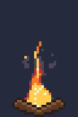
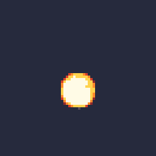
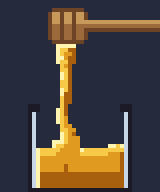
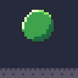
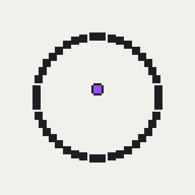
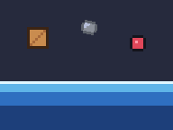

# Pixelbolt

[English](https://github.com/skulitom/Pixelbolt/blob/main/README.md) · [简体中文](https://github.com/skulitom/Pixelbolt/blob/main/README.zh-CN.md) · [日本語](https://github.com/skulitom/Pixelbolt/blob/main/README.ja.md) · [한국어](https://github.com/skulitom/Pixelbolt/blob/main/README.ko.md) · Español · [Português](https://github.com/skulitom/Pixelbolt/blob/main/README.pt-BR.md) · [Русский](https://github.com/skulitom/Pixelbolt/blob/main/README.ru.md)

> Este documento es un resumen en español del README en inglés. Para los detalles de cada función, los límites y los cambios más recientes, consulta el [README en inglés](https://github.com/skulitom/Pixelbolt/blob/main/README.md). Si hay diferencias, prevalece el README en inglés.

**Pixel art y animación de sprites que tu agente de IA puede crear, revisar y corregir.** Pixelbolt convierte una receta JSON editable en sprites, tiles, iconos, efectos y animaciones cortas, y los exporta como hojas de sprites PNG, atlas de texturas, PNG animados (APNG), GIF y fotogramas PNG numerados para editores de video. Los agentes lo usan a través de un servidor MCP local o de la línea de comandos; tú puedes abrir, reproducir y editar la misma receta en un estudio local en el navegador.


- **[La galería](https://skulitom.github.io/Pixelbolt/gallery/):** 66 efectos, sprites y escenas de pixel art hechos con Pixelbolt 0.11.0, todos en movimiento y cada uno a un clic de su receta en el playground.
- **[Pruébalo en el navegador](https://skulitom.github.io/Pixelbolt/playground/):** renderiza, exporta y comparte recetas sin instalar nada.
- **[Juega con los píxeles](https://skulitom.github.io/Pixelbolt/playground/fluids/):** sopla sobre una fogata de pixel art en vivo, vierte miel y slime, y luego guarda un GIF o comparte un enlace que reproduce exactamente lo que hiciste.
- **[Guías de efectos](https://skulitom.github.io/Pixelbolt/guides/) (en inglés):** fuego, explosiones, humo y vapor, agua, slime y miel, y magia, cada una con recetas que se abren en el playground.
- **[Neon Voyage](https://skulitom.github.io/NeonRocketGame/):** un juego gratuito para navegador hecho con Pixelbolt. Cada sprite, efecto y letra es una [receta](https://github.com/skulitom/NeonRocketGame/tree/main/art), y la estela del cohete es una simulación de fluidos en vivo que se curva cuando giras.

 

El fuego, el humo, el vapor, las explosiones, la magia, el agua, la miel, el slime y la arena salen de una simulación de fluidos real que corre en tu propia CPU en mucho menos de un segundo y convierte cada fotograma en píxeles de paleta editables, con bucles sin costuras (consulta [Fluidos y cuerpos rígidos](#fluidos-y-cuerpos-rígidos)).

- **Para quién es:** desarrolladores de videojuegos, equipos de game jams y creadores web o de video que quieren que un agente como Claude, Codex o Cursor dibuje y corrija su pixel art, y quienes construyen agentes que necesitan imágenes exactas y repetibles.
- **Úsalo cuando** quieras recursos 2D pequeños para juegos que sigan siendo editables como texto: el agente vuelve a leer cada píxel, corrige un píxel o un fotograma sin redibujar el resto, y la misma receta produce siempre la misma imagen.
- **No lo uses para** imágenes pictóricas o fotográficas, animaciones grandes (un fotograma de animación mide como máximo 1024 píxeles por lado y 262 144 píxeles, como 320 × 180, 640 × 360 o 512 × 512, y un proyecto tiene como máximo 256 fotogramas y 4 194 304 píxeles en total, es decir, 72 fotogramas de 320 × 180; una imagen fija de un solo fotograma, como un fondo o un mural de 1920 × 1080, puede medir hasta 4096 píxeles por lado dentro de ese total), generar arte con un modelo de imágenes ni editar GIF o archivos de Aseprite (solo importa PNG de hasta 8 bits por canal).

## Pruébalo

Solo necesitas Node.js 20 o posterior. No hay nada más que instalar, ni clave de API, ni servicio de red:

```sh
git clone https://github.com/skulitom/Pixelbolt.git
cd Pixelbolt
node bin/pixelbolt.js preview --open
```

Se abre el estudio local en tu navegador (normalmente en http://127.0.0.1:4747; si ese puerto está ocupado, usa uno libre y muestra su dirección). Elige el espíritu del bosque, la fogata o la moneda; edita el JSON; revisa la animación o la hoja de sprites, y descarga el ZIP de recursos. El estudio incluye velocidad de reproducción, selección de fotogramas, zoom en múltiplos enteros, cuadrícula de píxeles, papel cebolla, inspección de la paleta, descarga en GIF de la animación actual y recuperación de los cambios sin guardar.


También puedes generar un recurso sin abrir el navegador:

```sh
node bin/pixelbolt.js init hero.pixel.json
node bin/pixelbolt.js validate hero.pixel.json
node bin/pixelbolt.js inspect hero.pixel.json --out hero-frames.png
node bin/pixelbolt.js render hero.pixel.json --out output/hero
```

`inspect` guarda una hoja de contactos con todos los fotogramas y lista la duración de cada uno; con `--grid` devuelve los fotogramas como texto de claves de paleta. `node bin/pixelbolt.js gif hero.pixel.json --out hero.gif` guarda una animación como GIF para compartir. Salvo la ayuda y el servidor de vista previa, los comandos responden en JSON. Los errores se escriben en stderr y el comando termina con el código de salida 1. Los archivos de salida que ya existen están protegidos; añade `--force` para reemplazarlos.

Pixelbolt se llamaba PixelForge hasta la versión 0.8.0. El comando `pixelforge` sigue funcionando como alias y las recetas conservan sus etiquetas de formato `pixelforge-*`, así que los archivos y las configuraciones de agentes que ya tienes siguen funcionando.

## Dáselo a tu agente

**Skill para Claude Code:** una sola línea instala la skill de pixel art, sin clonar nada ni configurar un servidor MCP (Pixelbolt 0.9.2 o posterior):

```sh
npx -y pixelbolt@latest skill install
```

Se instala en `~/.claude/skills/pixelbolt-pixel-art/` (`--project` la instala en `.claude/skills/` de la carpeta actual, y `--dir` en cualquier carpeta de skills). La skill ejecuta cada comando que menciona con `npx -y pixelbolt@<esa versión>`, y el instalador nunca reemplaza una copia que hayas modificado salvo que añadas `--force`.

Para Codex, Cursor y los demás agentes compatibles con la [CLI abierta de skills](https://skills.sh), usa `npx skills add skulitom/Pixelbolt`. Copia solo el archivo de la skill, que luego ejecuta Pixelbolt con npx. La CLI de skills necesita Node.js 22.20 o posterior y envía los datos de cada instalación a la tabla de clasificación de skills.sh, salvo que definas `DISABLE_TELEMETRY=1`.

**Plugin para Claude Code:** un comando instala el servidor MCP y la misma skill (Claude Code 2.1.292 o posterior):

```
claude plugin install pixelbolt --marketplace skulitom/Pixelbolt
```

Dentro de una sesión, `/plugin install pixelbolt --marketplace skulitom/Pixelbolt` hace lo mismo desde Claude Code 2.1.275. En versiones anteriores, añade primero el marketplace con `claude plugin marketplace add skulitom/Pixelbolt` y luego ejecuta `claude plugin install pixelbolt@pixelbolt`. Las referencias a archivos se resuelven dentro de la carpeta del proyecto que abras en Claude Code, y las exportaciones van a su carpeta `output/`. Reinicia Claude Code después de instalarlo.

**Claude Desktop:** descarga [`pixelbolt.mcpb`](https://github.com/skulitom/Pixelbolt/releases/latest/download/pixelbolt.mcpb) de la última versión publicada y ábrelo (o instálalo desde un archivo en Configuración → Extensiones [Settings → Extensions]). Elige una carpeta de trabajo para las recetas y el arte, y pide al agente que llame a `pixel_help`.

**Otros clientes MCP (Codex, Cursor, etc.):** el paquete de npm ejecuta el servidor sin clonar nada (Node.js 20 o posterior). Añádelo a la configuración MCP de tu agente y sustituye `/absolute/path/to/pixelbolt-output` por la carpeta donde quieras guardar las exportaciones. Usa una ruta absoluta, porque cada cliente inicia los servidores en una carpeta distinta; en Windows usa barras diagonales (`/`), por ejemplo `C:/Art/pixelbolt-output`:

```json
{
  "mcpServers": {
    "pixelbolt": {
      "command": "npx",
      "args": ["-y", "pixelbolt@latest", "mcp", "--out", "/absolute/path/to/pixelbolt-output"]
    }
  }
}
```

Para clientes que usan TOML (como Codex):

```toml
[mcp_servers.pixelbolt]
command = "npx"
args = ["-y", "pixelbolt@latest", "mcp", "--out", "/absolute/path/to/pixelbolt-output"]
```

En Windows, un cliente que inicia el servidor sin un shell no puede ejecutar `npx` (Kimi Code informa `spawn npx ENOENT`). En ese caso usa `"command": "cmd"` con `"args": ["/c", "npx", "-y", "pixelbolt@latest", "mcp", "--out", "C:/Art/pixelbolt-output"]`. Para ejecutar una copia clonada del repositorio (por ejemplo `main`, que puede ir por delante de npm) y para configurar Kimi Code, DeepSeek Harness y OpenCode, consulta [Connect an agent through MCP](https://github.com/skulitom/Pixelbolt#connect-an-agent-through-mcp) en el README en inglés.

Pixelbolt figura en el MCP Registry oficial como `io.github.skulitom/pixelbolt`.

### Las ocho herramientas MCP

- **`pixel_help`:** una guía rápida breve (el formato de receta, las operaciones, las herramientas y el flujo de trabajo). Empieza por aquí. Con `topic` devuelve la guía de creación completa (`guide`), el flujo de trabajo artístico (`workflow`), el JSON Schema de las recetas (`schema`), un ejemplo completo (`example`) o los esquemas `poses`, `scenes`, `autotile`, `fx`, `fluid`, `wave`, `bodies` y `normals`. El tema `presets` lista los presets incluidos (fuego, humo, explosiones, hechizos, líquidos, plasma, cuerpos rígidos, personajes) para compilarlos en lugar de dibujarlos.
- **`pixel_validate`:** valida una receta y guarda su revisión sin exportar recursos. Informa de cada zona recortada por el lienzo; con `"fps": 30` también indica qué duraciones no encajan en esa cuadrícula de fotogramas de video.
- **`pixel_inspect`:** hojas de contactos, cuadrículas exactas por región, vistas de silueta, escala de grises y papel cebolla, repeticiones de tiles en 3×3 para ver las costuras, tamaño nativo, diagnósticos, revisión del movimiento (apoyo de los pies y unión del bucle) y guías de perspectiva (horizonte, puntos de fuga, cuadrícula isométrica).
- **`pixel_patch`:** corrige solo lo necesario con ediciones `set`, `insert`, `remove` y `paint`. Por ejemplo, `{ "paint": "frames[blink]", "value": [{ "x": 9, "y": 7, "color": "k" }] }` corrige un píxel en las coordenadas finales del lienzo, después de todas las capas. Devuelve cada fotograma cuyos píxeles cambiaron (con los píxeles exactos si la edición es pequeña) y un PNG de antes y después; la receta original no cambia y cada edición correcta crea una revisión nueva.
- **`pixel_render`:** exporta la hoja de sprites, el atlas JSON, un PNG por fotograma, los APNG, el CSS y el reproductor Canvas, y devuelve una hoja de contactos de todos los fotogramas. Con `"gif": {}` también escribe GIF, y con `"sequence": { "fps": 30, "size": "1080p" }`, fotogramas PNG numerados para un editor de video. Cada llamada escribe en una carpeta nueva dentro de la carpeta de salida.
- **`pixel_compile`:** compila fuentes de poses, autotiles, efectos de partículas y hechizos (fx), fluidos (fluid), ondas (wave), cuerpos rígidos (bodies) y mapas de normales (normals) en una receta ordinaria. Con `preset` compila por nombre uno de los presets incluidos.
- **`pixel_scene`:** renderiza un manifiesto de escena (tilemaps con leyendas de autotile, señales (cues), trayectorias, objetos unidos a otros, orden de dibujo según el suelo, luces puntuales y de sol con sombras proyectadas, cámara con paneo y paralaje), lo exporta (con un mapa de Tiled cuyas capas llevan el paralaje de cada plano, `scene.tmx`, copias con neblina de los recursos lejanos y una escena de Godot que desplaza cada plano con `Parallax2D`, `scene.tscn`) o lo escribe como fotogramas PNG numerados.
- **`pixel_import`:** importa un PNG a resolución nativa (RGB, RGBA, escala de grises o indexado, hasta 8 bits por canal) como una revisión de receta editable y sin pérdidas.

Cada respuesta correcta de una herramienta de recetas incluye un id de `revision` que las demás herramientas aceptan en lugar de la receta completa, así que no hace falta volver a enviarla. Las revisiones se guardan como instantáneas inmutables en `.revisions/`, dentro de la carpeta `--out` del servidor MCP, y sobreviven a los reinicios si usas la misma carpeta.

## Una animación diminuta

```json
{
  "version": 1,
  "name": "slime",
  "width": 8,
  "height": 8,
  "palette": { "g": "#72b58d", "e": "#20383f" },
  "frames": [
    {
      "name": "rest",
      "duration": 180,
      "ops": [{ "op": "grid", "x": 1, "y": 3,
        "rows": [".gggg.", "ggeegg", "gggggg", ".gggg."] }]
    },
    { "name": "up", "from": "rest", "translate": [0, -1], "duration": 180 }
  ],
  "animations": { "bounce": { "frames": ["rest", "up"] } }
}
```

Cada carácter de la cuadrícula de texto elige un color de la paleta; `.` y el espacio dejan los píxeles como están. La herencia entre fotogramas permite describir cambios pequeños con poco texto. El renderizado es determinista y usa coordenadas de píxel enteras.

## Fluidos y cuerpos rígidos

Una fuente `pixelforge-fluid` ejecuta una simulación de fluidos pequeña y determinista y la compila en una receta ordinaria hecha de cuadrículas de paleta: gases con flotación y remolinos; líquidos tan fluidos como el agua, espesos como la miel o firmes como el slime; arena que mantiene su pendiente; arcos eléctricos y plasma, y hielo que se derrite y agua que se congela y hierve. La densidad, la temperatura y la velocidad se asignan a las rampas de tu paleta con tramado ordenado (ordered dither), así que nunca aparece un color que no esté en la paleta.

 

Una fuente `pixelforge-bodies` deja caer pelotas, cajas, polígonos y aros giratorios en un lienzo con gravedad, paredes y obstáculos de píxeles: rebotan, se deslizan, ruedan, se apilan y se detienen, y todo se convierte en cuadrículas de paleta como en los demás compiladores. Las articulaciones conectan cuerpos en ragdolls, las cuerdas cuelgan y se rompen, y las telas se pinzan a cuerpos, ondulan con el viento, se drapean y se desgarran. Los mismos cuerpos funcionan dentro de un fluido: flotan o se hunden en el agua según su densidad y se deslizan con la arena cuando esta se desmorona.

 

```sh
node bin/pixelbolt.js compile examples/campfire.fluid.json --out output/campfire.json
node bin/pixelbolt.js gif output/campfire.json --scale 4 --out output/campfire.gif
```

Los presets están en [examples/](https://github.com/skulitom/Pixelbolt/tree/main/examples) (`*.fluid.json` y `*.bodies.json`). Los agentes los compilan con `pixel_compile` de MCP y leen el formato con los temas `fluid` y `bodies` de `pixel_help`. En el estudio, **Fluid lab** (`/fluid.html`) ejecuta el mismo compilador en tu navegador: elige un preset, mueve unos cuantos controles deslizantes y descarga el GIF, la hoja de sprites o la receta. **Effects lab** (`/effects.html`) hace lo mismo con los presets de hechizos y partículas de `pixelforge-fx`.

## Archivos exportados

| Archivo | Uso |
| --- | --- |
| `name.png` | Hoja de sprites PNG RGBA, con columnas, márgenes y escala entera configurables, o empaquetada según la zona visible con `sheet.trim` |
| `name.atlas.json` | Atlas JSON al estilo de TexturePacker: rectángulos, desplazamientos de recorte, tamaños originales, pivotes y puntos de anclaje, puntos con nombre, duraciones de fotograma, animaciones con nombre y etiquetas de fotograma al estilo de Aseprite |
| `name.tres` | `SpriteFrames` de Godot 4 para `AnimatedSprite2D`, con el bucle y los tiempos exactos de cada animación; guárdalo junto a `name.png` |
| `name.tileset.tres` | Solo para conjuntos de tiles: un `TileSet` de Godot 4 para `TileMapLayer`, con la probabilidad y la colisión de cada tile, con el que el pintor de terrenos de Godot elige el mismo tile que el tilemap de Pixelbolt; guárdalo junto a `name.png` |
| `name.tsx` | Solo para conjuntos de tiles: un tileset de [Tiled](https://www.mapeditor.org) con un conjunto Wang por terreno para el pincel de terrenos, y la probabilidad, los objetos de colisión y la animación de cada tile; guárdalo junto a `name.png` |
| `frames/*.png` | Cada fotograma como PNG transparente |
| `animations/*.png` | Un APNG por animación, que conserva la transparencia, los tiempos de los fotogramas y el bucle |
| `name.css` | Clases de animación CSS; admite hojas de varias filas y fotogramas de duraciones distintas |
| `player.js` | Reproductor Canvas pequeño y sin dependencias, con reproducción, pausa, reanudación y animaciones con nombre, además de `loadSpriteSheet`, `frameAt` y `drawFrame` para juegos |
| `name.pixel.json` | Receta de origen editable |
| `preview.html` | Vista previa independiente que puedes abrir directamente en el navegador |

Los archivos APNG usan la extensión `.png` a propósito. En Godot 4, pon `name.png` y `name.tres` en la misma carpeta del proyecto y usa el `.tres` como Sprite Frames de un `AnimatedSprite2D`. Phaser lee el formato de hash JSON con `load.atlas`; en otros motores, usa los rectángulos del atlas o los PNG individuales. Más detalles en las [notas de integración con juegos](https://github.com/skulitom/Pixelbolt/blob/main/docs/game-integration.md) (en inglés).

## Más documentación (en inglés)

- [README en inglés](https://github.com/skulitom/Pixelbolt/blob/main/README.md): todos los comandos, las exportaciones, los fotogramas para editores de video, la API de JavaScript y las versiones portables
- [Guía de creación](https://github.com/skulitom/Pixelbolt/blob/main/docs/agent-guide.md): campos de la receta, operaciones de dibujo y límites
- [Flujo de trabajo artístico](https://github.com/skulitom/Pixelbolt/blob/main/docs/art-workflow.md): revisión de silueta y valores, poses y movimiento, autotiles, escenas, fluidos y cuerpos rígidos
- [Skill de pixel art](https://github.com/skulitom/Pixelbolt/blob/main/skills/pixelbolt-pixel-art/SKILL.md): un flujo reutilizable para crear y revisar
- [Ejemplos](https://github.com/skulitom/Pixelbolt/tree/main/examples) y [cómo se hizo la galería](https://github.com/skulitom/Pixelbolt/blob/main/showcase/gallery/README.md)
- [llms.txt](https://github.com/skulitom/Pixelbolt/blob/main/llms.txt): índice de la documentación para agentes
- [CONTRIBUTING.md](https://github.com/skulitom/Pixelbolt/blob/main/CONTRIBUTING.md) y [AGENTS.md](https://github.com/skulitom/Pixelbolt/blob/main/AGENTS.md): cómo contribuir. Informa de los errores en [GitHub Issues](https://github.com/skulitom/Pixelbolt/issues)

## Otras herramientas del mismo autor

Todas son gratuitas, con licencia MIT, se ejecutan en local y funcionan como servidores MCP:

- [Anode](https://github.com/skulitom/Anode): automatización del escritorio de Windows en una sesión oculta en segundo plano, para que un agente pueda hacer clic, escribir y tomar capturas de pantalla sin apoderarse de tu pantalla.
- [Cutbolt](https://github.com/skulitom/Cutbolt): un motor de edición de video con líneas de tiempo exactas, subtítulos y renderizado.
- [Inkbolt](https://github.com/skulitom/Inkbolt): edición de imágenes vectoriales y rasterizadas para diagramas e ilustraciones, con importación de SVG y exportación a SVG o PDF.
- [Nestbolt](https://github.com/skulitom/Nestbolt): anidado 2D de piezas en láminas para corte por láser, CNC, plasma y chorro de agua, también [en tu navegador](https://skulitom.github.io/Nestbolt/).

## Licencia

[Licencia MIT](https://github.com/skulitom/Pixelbolt/blob/main/LICENSE). El arte incluido es original y está cubierto por la misma licencia.
