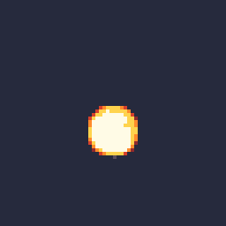
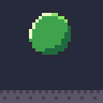
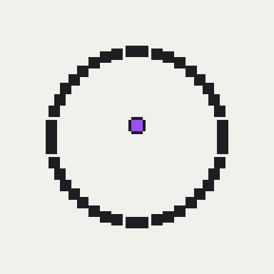
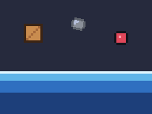

# Pixelbolt

[English](https://github.com/skulitom/Pixelbolt/blob/main/README.md) · [简体中文](https://github.com/skulitom/Pixelbolt/blob/main/README.zh-CN.md) · [日本語](https://github.com/skulitom/Pixelbolt/blob/main/README.ja.md) · 한국어 · [Español](https://github.com/skulitom/Pixelbolt/blob/main/README.es.md) · [Português](https://github.com/skulitom/Pixelbolt/blob/main/README.pt-BR.md) · [Русский](https://github.com/skulitom/Pixelbolt/blob/main/README.ru.md)

> 이 문서는 영어 README를 한국어로 요약한 것입니다. 기능의 자세한 내용, 제한 사항, 최신 변경 사항은 [영어 README](https://github.com/skulitom/Pixelbolt/blob/main/README.md)를 확인하세요. 내용이 다르면 영어 README가 우선합니다.

**AI 에이전트가 만들고, 확인하고, 고칠 수 있는 픽셀 아트와 스프라이트 애니메이션.** Pixelbolt는 편집 가능한 JSON 레시피로 스프라이트, 타일, 아이콘, 이펙트, 짧은 애니메이션을 만들고, PNG 스프라이트 시트, 텍스처 아틀라스, 애니메이션 PNG(APNG), GIF, 영상 편집 프로그램용 번호 붙은 PNG 프레임으로 내보냅니다. 에이전트는 로컬 MCP 서버나 명령줄로 Pixelbolt를 사용하고, 사람은 같은 레시피를 로컬 브라우저 스튜디오에서 열어 재생하고 편집할 수 있습니다.


- **[갤러리](https://skulitom.github.io/Pixelbolt/gallery/):** Pixelbolt 0.11.0으로 만든 픽셀 아트 이펙트, 스프라이트, 장면 66개. 모두 움직이며, 클릭 한 번으로 플레이그라운드에서 해당 레시피를 열 수 있습니다.
- **[브라우저에서 써 보기](https://skulitom.github.io/Pixelbolt/playground/):** 아무것도 설치하지 않고 레시피를 렌더링하고, 내보내고, 공유할 수 있습니다.
- **[픽셀 만져 보기](https://skulitom.github.io/Pixelbolt/playground/fluids/):** 실시간으로 움직이는 픽셀 아트 모닥불에 바람을 불어 넣고, 꿀과 슬라임을 부어 본 뒤 GIF로 저장하거나, 내가 한 동작을 그대로 다시 재생하는 링크를 공유할 수 있습니다.
- **[이펙트 가이드](https://skulitom.github.io/Pixelbolt/guides/)(영어):** 불, 폭발, 연기와 증기, 물, 슬라임과 꿀, 마법. 가이드마다 플레이그라운드에서 바로 열리는 레시피가 있습니다.
- **[Neon Voyage](https://skulitom.github.io/NeonRocketGame/):** Pixelbolt로 만든 무료 브라우저 게임. 모든 스프라이트, 이펙트, 글자가 [레시피](https://github.com/skulitom/NeonRocketGame/tree/main/art)이고, 로켓의 배기 불꽃은 조종에 따라 휘어지는 실시간 유체 시뮬레이션입니다.

 

불, 연기, 증기, 폭발, 마법, 물, 꿀, 슬라임, 모래는 실제 유체 시뮬레이션에서 나옵니다. 내 컴퓨터의 CPU에서 1초도 채 걸리지 않고 계산되며, 모든 프레임은 편집 가능한 팔레트 픽셀로 구워지고, 루프는 이음새 없이 이어집니다([유체 이펙트와 강체](#유체-이펙트와-강체) 참고).

- **누구를 위한 도구인가:** Claude, Codex, Cursor 같은 에이전트에게 픽셀 아트를 그리고 고치게 하고 싶은 게임 개발자, 게임잼 팀, 웹·영상 제작자, 그리고 정확하고 재현 가능한 이미지가 필요한 에이전트를 만드는 사람.
- **이럴 때 쓰세요:** 텍스트로 계속 편집할 수 있는 작은 2D 게임 에셋이 필요할 때. 에이전트는 모든 픽셀을 다시 읽을 수 있고, 나머지를 다시 그리지 않고 픽셀 하나나 프레임 하나만 고칠 수 있으며, 같은 레시피는 언제나 같은 이미지를 렌더링합니다.
- **이럴 때는 맞지 않습니다:** 회화풍이나 사진 같은 이미지, 큰 애니메이션(애니메이션 프레임은 한 변 최대 1024픽셀, 면적 최대 262,144픽셀로 320 × 180, 640 × 360, 512 × 512가 들어가고, 프로젝트는 최대 256프레임에 전체 4,194,304픽셀까지라 320 × 180이면 72프레임, 1920 × 1080 배경이나 벽화 같은 단일 정지 이미지는 이 총량 안에서 한 변 최대 4096픽셀), 이미지 생성 모델로 아트 만들기, GIF나 Aseprite 파일 편집(가져오기는 채널당 최대 8비트 PNG만 지원).

## 써 보기

Node.js 20 이상만 있으면 됩니다. 설치할 의존성도, API 키도, 네트워크 서비스도 필요 없습니다:

```sh
git clone https://github.com/skulitom/Pixelbolt.git
cd Pixelbolt
node bin/pixelbolt.js preview --open
```

브라우저에서 로컬 스튜디오가 열립니다(기본 주소는 http://127.0.0.1:4747이며, 포트가 사용 중이면 빈 포트를 골라 그 주소를 출력합니다). 숲의 정령, 모닥불, 동전 예제를 골라 JSON을 편집하고, 애니메이션이나 스프라이트 시트를 확인한 뒤 에셋 ZIP을 내려받을 수 있습니다. 스튜디오에는 재생 속도, 프레임 선택, 정수 배율 확대, 픽셀 격자, 어니언 스킨, 팔레트 확인, 현재 애니메이션의 GIF 다운로드, 저장하지 않은 편집 내용 복구 기능이 있습니다.


브라우저를 열지 않고 에셋을 만들 수도 있습니다:

```sh
node bin/pixelbolt.js init hero.pixel.json
node bin/pixelbolt.js validate hero.pixel.json
node bin/pixelbolt.js inspect hero.pixel.json --out hero-frames.png
node bin/pixelbolt.js render hero.pixel.json --out output/hero
```

`inspect`는 모든 프레임을 한 장에 모은 컨택트 시트를 저장하고 각 프레임의 표시 시간을 나열합니다. `--grid`를 붙이면 프레임을 팔레트 키 텍스트로 다시 읽습니다. `node bin/pixelbolt.js gif hero.pixel.json --out hero.gif`는 애니메이션 하나를 공유용 GIF로 저장합니다. 도움말과 미리 보기 서버를 제외한 명령 결과는 JSON입니다. 오류는 stderr로 출력되고 종료 코드 1로 끝납니다. 이미 있는 출력 파일은 보호되며, 바꾸려면 `--force`를 붙이세요.

Pixelbolt는 0.8.0까지 PixelForge라는 이름이었습니다. `pixelforge` 명령은 별칭으로 계속 동작하고, 레시피 파일은 `pixelforge-*` 형식 태그를 그대로 쓰므로 기존 파일과 에이전트 설정도 그대로 동작합니다.

## 에이전트에게 맡기기

**Claude Code 스킬:** 명령 한 줄로 픽셀 아트 스킬을 설치합니다. 저장소를 클론할 필요도, MCP 서버도 필요 없습니다(Pixelbolt 0.9.2 이상):

```sh
npx -y pixelbolt@latest skill install
```

스킬은 `~/.claude/skills/pixelbolt-pixel-art/`에 설치됩니다(`--project`는 현재 폴더의 `.claude/skills/`에, `--dir`는 원하는 스킬 폴더에 설치합니다). 스킬이 안내하는 모든 명령은 `npx -y pixelbolt@<해당 버전>`으로 실행되고, 직접 고친 사본은 `--force`를 붙이지 않는 한 덮어쓰지 않습니다.

Codex, Cursor 등 공개 [skills CLI](https://skills.sh)가 지원하는 다른 에이전트에서는 `npx skills add skulitom/Pixelbolt`를 쓰세요. 스킬 파일만 복사하며, 그 스킬이 npx로 Pixelbolt를 실행합니다. skills CLI는 Node.js 22.20 이상이 필요하고, `DISABLE_TELEMETRY=1`을 설정하지 않으면 설치 기록을 skills.sh 순위표에 보고합니다.

**Claude Code 플러그인:** MCP 서버와 위의 픽셀 아트 스킬을 한 번에 설치합니다(Claude Code 2.1.292 이상):

```
claude plugin install pixelbolt --marketplace skulitom/Pixelbolt
```

세션 안에서는 `/plugin install pixelbolt --marketplace skulitom/Pixelbolt`가 같은 일을 합니다(Claude Code 2.1.275 이상). 그보다 오래된 버전에서는 먼저 `claude plugin marketplace add skulitom/Pixelbolt`로 마켓플레이스를 추가한 뒤 `claude plugin install pixelbolt@pixelbolt`를 실행하세요. 파일 참조는 Claude Code에서 연 프로젝트 폴더 안에서 찾고, 내보낸 파일은 그 폴더의 `output/`에 저장됩니다. 설치한 뒤에는 Claude Code를 다시 시작하세요.

**Claude Desktop:** 최신 릴리스에서 [`pixelbolt.mcpb`](https://github.com/skulitom/Pixelbolt/releases/latest/download/pixelbolt.mcpb)를 내려받아 엽니다(또는 설정(Settings) → 확장 프로그램(Extensions)에서 파일로 설치합니다). 레시피와 아트워크를 둘 작업 폴더를 고른 다음, 에이전트에게 `pixel_help`를 호출해 달라고 하세요.

**그 밖의 MCP 클라이언트(Codex, Cursor 등):** npm 패키지로 서버를 바로 실행하므로 클론할 필요가 없습니다(Node.js 20 이상). 아래 내용을 에이전트의 MCP 설정에 추가하고, `/absolute/path/to/pixelbolt-output`을 내보낸 파일을 저장할 폴더로 바꾸세요. 클라이언트마다 서버를 시작하는 폴더가 다르므로 절대 경로를 써야 합니다. Windows에서는 `C:/Art/pixelbolt-output`처럼 슬래시(/)를 씁니다:

```json
{
  "mcpServers": {
    "pixelbolt": {
      "command": "npx",
      "args": ["-y", "pixelbolt@latest", "mcp", "--out", "/absolute/path/to/pixelbolt-output"]
    }
  }
}
```

TOML을 쓰는 클라이언트(Codex 등):

```toml
[mcp_servers.pixelbolt]
command = "npx"
args = ["-y", "pixelbolt@latest", "mcp", "--out", "/absolute/path/to/pixelbolt-output"]
```

Windows에서 셸 없이 서버를 시작하는 클라이언트는 `npx`를 실행하지 못합니다(Kimi Code는 `spawn npx ENOENT`를 보고합니다). 그럴 때는 `"command": "cmd"`와 `"args": ["/c", "npx", "-y", "pixelbolt@latest", "mcp", "--out", "C:/Art/pixelbolt-output"]`을 쓰세요. 저장소를 클론해 실행하는 방법(npm보다 앞설 수 있는 `main` 브랜치 등)과 Kimi Code, DeepSeek Harness, OpenCode 설정은 영어 README의 [Connect an agent through MCP](https://github.com/skulitom/Pixelbolt#connect-an-agent-through-mcp)를 참고하세요.

Pixelbolt는 공식 MCP Registry에 `io.github.skulitom/pixelbolt`로 등록되어 있습니다.

### MCP 도구 8개

- **`pixel_help`:** 짧은 빠른 시작(레시피 형식, 연산, 도구, 워크플로). 여기서 시작하세요. `topic`으로 전체 작성 가이드(`guide`), 아트 워크플로(`workflow`), 레시피 JSON Schema(`schema`), 완성된 예제(`example`), 또는 poses·scenes·autotile·fx·fluid·wave·bodies·normals 스키마를 받을 수 있습니다. `presets` 토픽은 직접 그리는 대신 컴파일해 쓸 수 있는 프리셋(불, 연기, 폭발, 마법, 액체, 플라스마, 강체, 캐릭터) 목록을 보여 줍니다.
- **`pixel_validate`:** 레시피를 검사하고, 에셋은 내보내지 않은 채 리비전을 저장합니다. 캔버스 밖으로 잘린 위치를 모두 보고하며, `"fps": 30`을 주면 그 영상 프레임 격자에 맞지 않는 표시 시간도 알려 줍니다.
- **`pixel_inspect`:** 컨택트 시트, 영역별 정확한 격자, 실루엣·그레이스케일·어니언 스킨 보기, 이음새를 확인하는 3×3 타일 반복, 원본 크기 보기, 진단 정보, 발 접지와 루프 연결을 보는 동작 검토, 원근 가이드(지평선, 소실점, 아이소메트릭 격자)를 제공합니다.
- **`pixel_patch`:** `set`, `insert`, `remove`, `paint`로 원하는 부분만 고칩니다. 예를 들어 `{ "paint": "frames[blink]", "value": [{ "x": 9, "y": 7, "color": "k" }] }`는 모든 레이어를 합친 최종 캔버스 좌표에서 픽셀 하나를 고칩니다. 픽셀이 바뀐 프레임(작은 편집은 정확한 픽셀까지)과 전후 비교 PNG를 돌려주며, 원본은 그대로 두고 새 리비전을 만듭니다.
- **`pixel_render`:** 스프라이트 시트, 아틀라스 JSON, 프레임별 PNG, APNG, CSS, Canvas 플레이어를 내보내고, 모든 프레임의 컨택트 시트를 돌려줍니다. `"gif": {}`를 주면 GIF를, `"sequence": { "fps": 30, "size": "1080p" }`를 주면 영상 편집용 번호 붙은 PNG 프레임을 함께 저장합니다. 호출할 때마다 출력 폴더 안에 새 폴더를 만듭니다.
- **`pixel_compile`:** 포즈(poses), 오토타일(autotile), 파티클·마법 이펙트(fx), 유체(fluid), 웨이브(wave), 강체(bodies), 노멀(normals) 소스를 일반 레시피로 컴파일합니다. `preset`에 이름을 주면 기본 제공 프리셋을 컴파일합니다.
- **`pixel_scene`:** 장면 매니페스트(오토타일 범례가 있는 타일맵, 큐, 궤적, 어태치먼트, 지면 기준 정렬, 점광원·태양광 조명과 그림자, 패럴랙스 레이어가 있는 카메라 패닝)를 렌더링하고, 각 레이어에 평면의 패럴랙스를 담은 Tiled 맵(`scene.tmx`), 먼 에셋의 헤이즈 사본, 각 평면을 `Parallax2D`로 스크롤하는 Godot 장면(`scene.tscn`)과 함께 내보내거나 번호 붙은 PNG 프레임으로 저장합니다.
- **`pixel_import`:** 원본 해상도 PNG(RGB, RGBA, 그레이스케일, 인덱스 색상, 채널당 최대 8비트)를 손실 없이 편집 가능한 레시피 리비전으로 가져옵니다.

레시피를 다루는 도구는 성공할 때마다 `revision` ID를 돌려줍니다. 다음 호출부터는 레시피 전체 대신 이 ID를 넘기면 되므로, 같은 레시피를 다시 보낼 필요가 없습니다. 리비전은 MCP `--out` 폴더 안의 `.revisions/`에 바뀌지 않는 스냅샷으로 저장되어 같은 폴더를 쓰면 서버를 다시 시작해도 남습니다.

## 작은 애니메이션

```json
{
  "version": 1,
  "name": "slime",
  "width": 8,
  "height": 8,
  "palette": { "g": "#72b58d", "e": "#20383f" },
  "frames": [
    {
      "name": "rest",
      "duration": 180,
      "ops": [{ "op": "grid", "x": 1, "y": 3,
        "rows": [".gggg.", "ggeegg", "gggggg", ".gggg."] }]
    },
    { "name": "up", "from": "rest", "translate": [0, -1], "duration": 180 }
  ],
  "animations": { "bounce": { "frames": ["rest", "up"] } }
}
```

텍스트 격자의 각 문자는 팔레트 색 하나를 고릅니다. `.`과 공백은 픽셀을 건드리지 않습니다. 프레임 상속 덕분에 작은 변화를 짧게 적을 수 있습니다. 렌더링은 결정적이며 정수 픽셀 좌표만 씁니다.

## 유체 이펙트와 강체

`pixelforge-fluid` 소스는 작고 결정적인 유체 시뮬레이션을 돌려, 팔레트 격자로 된 일반 레시피로 컴파일합니다. 부력과 소용돌이가 있는 기체, 물처럼 묽거나 꿀처럼 걸쭉하거나 슬라임처럼 탱탱한 액체, 경사를 유지하는 모래, 전기 아크와 플라스마, 녹는 얼음과 얼고 끓는 물을 만들 수 있습니다. 밀도, 온도, 속도는 오더드 디더링으로 팔레트 램프에 매핑되므로 팔레트에 없는 색은 절대 나오지 않습니다.

 

`pixelforge-bodies` 소스는 공, 상자, 다각형, 회전하는 고리를 중력, 벽, 픽셀 장애물이 있는 캔버스에 떨어뜨립니다. 튀고, 미끄러지고, 구르고, 쌓이다가 멈추는 모습이 다른 컴파일러와 마찬가지로 팔레트 격자로 구워집니다. 유체 소스에 같은 강체를 넣으면 물에 떨어져 물보라를 일으키고 밀도에 따라 뜨거나 가라앉으며, 모래 위에 내려앉았다가 모래가 무너지면 함께 미끄러져 내려갑니다.

 

```sh
node bin/pixelbolt.js compile examples/campfire.fluid.json --out output/campfire.json
node bin/pixelbolt.js gif output/campfire.json --scale 4 --out output/campfire.gif
```

프리셋은 [examples/](https://github.com/skulitom/Pixelbolt/tree/main/examples)에 있습니다(`*.fluid.json`, `*.bodies.json`). 에이전트는 MCP `pixel_compile`로 컴파일하고, `pixel_help`의 `fluid`, `bodies` 토픽으로 형식을 읽습니다. 스튜디오의 **Fluid lab**(`/fluid.html`)은 같은 컴파일러를 브라우저에서 실행합니다. 프리셋을 고르고 슬라이더 몇 개를 움직인 뒤 GIF, 스프라이트 시트, 레시피를 내려받으세요. **Effects lab**(`/effects.html`)은 `pixelforge-fx` 마법·파티클 프리셋으로 같은 일을 합니다.

## 내보내는 파일

| 파일 | 용도 |
| --- | --- |
| `name.png` | RGBA PNG 스프라이트 시트. 열 수, 여백, 정수 배율을 정할 수 있고, `sheet.trim`으로 보이는 영역만 담아 빽빽하게 배치할 수도 있습니다 |
| `name.atlas.json` | TexturePacker 형식의 JSON 아틀라스: 사각형, 트림 오프셋, 원본 크기, 피벗과 앵커, 이름 붙은 점, 프레임 표시 시간, 이름 붙은 애니메이션, Aseprite 형식 프레임 태그 |
| `name.tres` | `AnimatedSprite2D`용 Godot 4 `SpriteFrames`. 모든 애니메이션의 반복 여부와 정확한 프레임 시간을 담습니다. `name.png`와 같은 폴더에 두세요 |
| `name.tileset.tres` | 타일셋에만 해당: `TileMapLayer`용 Godot 4 `TileSet`. Godot의 터레인으로 칠하면 Pixelbolt의 타일맵과 같은 타일이 골라지고, 타일마다 확률과 충돌 모양이 있습니다. `name.png`와 같은 폴더에 두세요 |
| `name.tsx` | 타일셋에만 해당: [Tiled](https://www.mapeditor.org) 타일셋. 터레인마다 Wang 세트가 있어 터레인 브러시로 칠할 수 있고, 타일마다 확률, 충돌 오브젝트, 애니메이션이 있습니다. `name.png`와 같은 폴더에 두세요 |
| `frames/*.png` | 프레임마다 하나씩 만든 투명 PNG |
| `animations/*.png` | 애니메이션마다 하나씩 만든 APNG. 투명도, 프레임 시간, 반복 설정을 유지합니다 |
| `name.css` | CSS 애니메이션 클래스. 여러 줄 시트와 서로 다른 프레임 시간을 지원합니다 |
| `player.js` | 의존성 없는 작은 Canvas 플레이어. 재생, 일시 정지, 이어서 재생, 이름 붙은 애니메이션과 게임용 `loadSpriteSheet`, `frameAt`, `drawFrame`을 제공합니다 |
| `name.pixel.json` | 편집 가능한 원본 레시피 |
| `preview.html` | 브라우저에서 바로 열 수 있는 독립 미리 보기 페이지 |

APNG 파일의 확장자는 일부러 `.png`로 되어 있습니다. Godot 4에서는 `name.png`와 `name.tres`를 프로젝트의 한 폴더에 두고 `.tres`를 `AnimatedSprite2D`의 Sprite Frames로 쓰세요. Phaser는 `load.atlas`로 JSON 해시 형식을 읽고, 다른 엔진에서는 아틀라스의 사각형이나 개별 PNG를 쓰면 됩니다. 자세한 내용은 [게임 연동 문서](https://github.com/skulitom/Pixelbolt/blob/main/docs/game-integration.md)(영어)를 참고하세요.

## 더 많은 문서(영어)

- [영어 README](https://github.com/skulitom/Pixelbolt/blob/main/README.md): 명령, 내보내기, 영상 편집용 프레임, JavaScript API, 포터블 빌드에 대한 전체 설명
- [작성 가이드](https://github.com/skulitom/Pixelbolt/blob/main/docs/agent-guide.md): 레시피 필드, 그리기 연산, 제한
- [아트 워크플로](https://github.com/skulitom/Pixelbolt/blob/main/docs/art-workflow.md): 실루엣과 명암 검토, 포즈와 동작, 오토타일, 장면, 유체와 강체
- [픽셀 아트 스킬](https://github.com/skulitom/Pixelbolt/blob/main/skills/pixelbolt-pixel-art/SKILL.md): 재사용할 수 있는 제작과 검토 절차
- [예제](https://github.com/skulitom/Pixelbolt/tree/main/examples)와 [갤러리 제작 과정](https://github.com/skulitom/Pixelbolt/blob/main/showcase/gallery/README.md)
- [llms.txt](https://github.com/skulitom/Pixelbolt/blob/main/llms.txt): 에이전트를 위한 문서 색인
- [CONTRIBUTING.md](https://github.com/skulitom/Pixelbolt/blob/main/CONTRIBUTING.md)와 [AGENTS.md](https://github.com/skulitom/Pixelbolt/blob/main/AGENTS.md): 기여 방법. 버그는 [GitHub Issues](https://github.com/skulitom/Pixelbolt/issues)로 알려 주세요

## 같은 제작자의 다른 도구

모두 무료이고 MIT 라이선스이며, 로컬에서 실행되고 MCP 서버로 쓸 수 있습니다:

- [Anode](https://github.com/skulitom/Anode): 숨겨진 백그라운드 세션에서 Windows 데스크톱을 자동화합니다. 에이전트가 클릭하고, 입력하고, 스크린숏을 찍어도 내 화면을 빼앗지 않습니다.
- [Cutbolt](https://github.com/skulitom/Cutbolt): 정확한 타임라인, 자막, 렌더링을 갖춘 영상 편집 엔진.
- [Inkbolt](https://github.com/skulitom/Inkbolt): 다이어그램과 일러스트를 위한 벡터·래스터 이미지 편집. SVG를 가져오고 SVG나 PDF로 내보냅니다.
- [Nestbolt](https://github.com/skulitom/Nestbolt): 레이저, CNC, 플라스마, 워터젯 절단을 위해 판재 위에 부품을 배치하는 2D 네스팅 도구. [브라우저에서도 쓸 수 있습니다](https://skulitom.github.io/Nestbolt/).

## 라이선스

[MIT 라이선스](https://github.com/skulitom/Pixelbolt/blob/main/LICENSE). 포함된 아트워크는 모두 오리지널이며 같은 라이선스가 적용됩니다.
