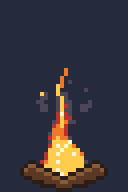
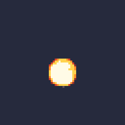
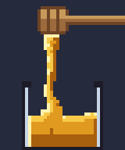
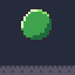
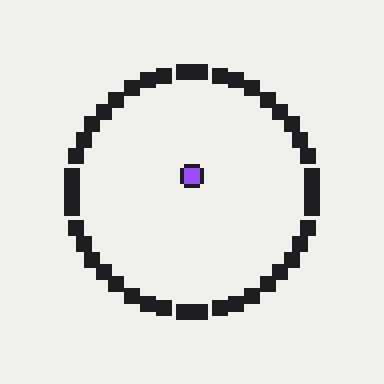
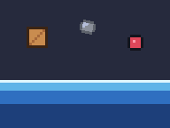

# Pixelbolt

[English](https://github.com/skulitom/Pixelbolt/blob/main/README.md) · [简体中文](https://github.com/skulitom/Pixelbolt/blob/main/README.zh-CN.md) · [日本語](https://github.com/skulitom/Pixelbolt/blob/main/README.ja.md) · [한국어](https://github.com/skulitom/Pixelbolt/blob/main/README.ko.md) · [Español](https://github.com/skulitom/Pixelbolt/blob/main/README.es.md) · Português · [Русский](https://github.com/skulitom/Pixelbolt/blob/main/README.ru.md)

> Este documento é um resumo em português do README em inglês. Para os detalhes de cada recurso, os limites e as mudanças mais recentes, consulte o [README em inglês](https://github.com/skulitom/Pixelbolt/blob/main/README.md). Se houver diferenças, vale o README em inglês.

**Pixel art e animação de sprites que o seu agente de IA consegue criar, conferir e corrigir.** O Pixelbolt transforma uma receita JSON editável em sprites, tiles, ícones, efeitos e animações curtas, e exporta tudo como spritesheets PNG, atlas de textura, PNGs animados (APNG), GIFs e quadros PNG numerados para editores de vídeo. Os agentes o usam por meio de um servidor MCP local ou da linha de comando; você pode abrir, reproduzir e editar a mesma receita em um estúdio local no navegador.


- **[A galeria](https://skulitom.github.io/Pixelbolt/gallery/):** 66 efeitos, sprites e cenas em pixel art feitos com o Pixelbolt 0.11.0, todos em movimento e cada um a um clique da sua receita no playground.
- **[Experimente no navegador](https://skulitom.github.io/Pixelbolt/playground/):** renderize, exporte e compartilhe receitas sem instalar nada.
- **[Brinque com os pixels](https://skulitom.github.io/Pixelbolt/playground/fluids/):** sopre uma fogueira de pixel art ao vivo, despeje mel e slime e depois salve um GIF ou compartilhe um link que reproduz exatamente o que você fez.
- **[Guias de efeitos](https://skulitom.github.io/Pixelbolt/guides/) (em inglês):** fogo, explosões, fumaça e vapor, água, slime e mel, e magia, cada um com receitas que abrem no playground. Também: spritesheets no Paper2D do Unreal Engine 5, conjuntos de autotiles gratuitos para Godot 4 e Tiled e seis spritesheets gratuitas de uma cachoeira em pixel art.
- **[Neon Voyage](https://skulitom.github.io/NeonRocketGame/):** um jogo gratuito para navegador feito com o Pixelbolt. Cada sprite, efeito e letra é uma [receita](https://github.com/skulitom/NeonRocketGame/tree/main/art), e o rastro do foguete é uma simulação de fluidos ao vivo que se curva quando você vira.

 

Fogo, fumaça, vapor, explosões, magia, água, mel, slime e areia vêm de uma simulação de fluidos de verdade, que roda no seu próprio processador em bem menos de um segundo e transforma cada quadro em pixels de paleta editáveis, com loops sem emendas (veja [Fluidos e corpos rígidos](#fluidos-e-corpos-rígidos)).

- **Para quem é:** desenvolvedores de jogos, equipes de game jam e criadores para web ou vídeo que querem que um agente como Claude, Codex ou Cursor desenhe e revise a sua pixel art, e quem constrói agentes que precisam de imagens exatas e reproduzíveis.
- **Use quando** você quiser assets 2D pequenos para jogos que continuem editáveis como texto: o agente relê cada pixel, corrige um pixel ou um quadro sem redesenhar o resto, e a mesma receita sempre gera a mesma imagem.
- **Não use para** imagens pictóricas ou fotográficas, animações grandes (um quadro de animação tem no máximo 1024 pixels de lado e 262.144 pixels, como 320 × 180, 640 × 360 ou 512 × 512, e um projeto tem no máximo 256 quadros e 4.194.304 pixels no total, ou seja, 72 quadros de 320 × 180; uma imagem estática de um só quadro, como um fundo ou um mural de 1920 × 1080, pode ter até 4096 pixels de lado dentro desse total), gerar arte com um modelo de imagens nem editar GIFs ou arquivos do Aseprite (ele importa apenas PNG, com até 8 bits por canal).

## Experimente

Você só precisa do Node.js 20 ou mais recente. Não há mais nada para instalar, nem chave de API, nem serviço de rede:

```sh
git clone https://github.com/skulitom/Pixelbolt.git
cd Pixelbolt
node bin/pixelbolt.js preview --open
```

O estúdio local abre no navegador (normalmente em http://127.0.0.1:4747; se essa porta estiver ocupada, ele usa uma livre e mostra o endereço). Escolha o espírito da floresta, a fogueira ou a moeda; edite o JSON; confira a animação ou a spritesheet e baixe o ZIP de assets. O estúdio tem velocidade de reprodução, seleção de quadros, zoom em múltiplos inteiros, grade de pixels, onion skin, inspeção da paleta, download da animação atual em GIF e recuperação de alterações não salvas.


Também dá para gerar um asset sem abrir o navegador:

```sh
node bin/pixelbolt.js init hero.pixel.json
node bin/pixelbolt.js validate hero.pixel.json
node bin/pixelbolt.js inspect hero.pixel.json --out hero-frames.png
node bin/pixelbolt.js render hero.pixel.json --out output/hero
```

`inspect` salva uma folha de contato com todos os quadros e lista a duração de cada um; com `--grid`, devolve os quadros como texto de chaves da paleta. `node bin/pixelbolt.js gif hero.pixel.json --out hero.gif` salva uma animação como GIF para compartilhar. Fora a ajuda e o servidor de pré-visualização, os comandos respondem em JSON. Os erros vão para o stderr e o comando sai com código 1. Arquivos de saída que já existem ficam protegidos; adicione `--force` para substituí-los.

O Pixelbolt se chamava PixelForge até a versão 0.8.0. O comando `pixelforge` continua funcionando como apelido e as receitas mantêm as etiquetas de formato `pixelforge-*`, então os seus arquivos e configurações de agentes continuam funcionando.

## Entregue ao seu agente

**Skill para o Claude Code:** uma linha instala a skill de pixel art, sem clonar nada nem configurar um servidor MCP (Pixelbolt 0.9.2 ou mais recente):

```sh
npx -y pixelbolt@latest skill install
```

Ela é instalada em `~/.claude/skills/pixelbolt-pixel-art/` (`--project` instala em `.claude/skills/` da pasta atual, e `--dir` em qualquer pasta de skills). A skill executa cada comando que menciona com `npx -y pixelbolt@<essa versão>`, e o instalador nunca substitui uma cópia que você modificou, a menos que você adicione `--force`.

Para o Codex, o Cursor e os outros agentes compatíveis com a [CLI aberta de skills](https://skills.sh), use `npx skills add skulitom/Pixelbolt`. Ela copia apenas o arquivo da skill, que depois executa o Pixelbolt via npx. A CLI de skills precisa do Node.js 22.20 ou mais recente e envia os dados de cada instalação para o ranking do skills.sh, a menos que você defina `DISABLE_TELEMETRY=1`.

**Plugin para o Claude Code:** um comando instala o servidor MCP e a mesma skill (Claude Code 2.1.292 ou mais recente):

```
claude plugin install pixelbolt --marketplace skulitom/Pixelbolt
```

Dentro de uma sessão, `/plugin install pixelbolt --marketplace skulitom/Pixelbolt` faz o mesmo a partir do Claude Code 2.1.275. Em versões anteriores, adicione primeiro o marketplace com `claude plugin marketplace add skulitom/Pixelbolt` e depois execute `claude plugin install pixelbolt@pixelbolt`. As referências a arquivos são resolvidas dentro da pasta do projeto aberta no Claude Code, e as exportações vão para a pasta `output/` dele. Reinicie o Claude Code depois de instalar.

**Claude Desktop:** baixe o [`pixelbolt.mcpb`](https://github.com/skulitom/Pixelbolt/releases/latest/download/pixelbolt.mcpb) da versão mais recente e abra-o (ou instale a partir de um arquivo em Settings → Extensions). Escolha uma pasta de trabalho para as receitas e a arte e peça ao agente para chamar `pixel_help`.

**Outros clientes MCP (Codex, Cursor etc.):** o pacote npm executa o servidor sem clonar nada (Node.js 20 ou mais recente). Adicione-o à configuração MCP do seu agente e troque `/absolute/path/to/pixelbolt-output` pela pasta onde as exportações devem ser salvas. Use um caminho absoluto, porque cada cliente inicia os servidores numa pasta diferente; no Windows, use barras normais (`/`), por exemplo `C:/Art/pixelbolt-output`:

```json
{
  "mcpServers": {
    "pixelbolt": {
      "command": "npx",
      "args": ["-y", "pixelbolt@latest", "mcp", "--out", "/absolute/path/to/pixelbolt-output"]
    }
  }
}
```

Para clientes que usam TOML (como o Codex):

```toml
[mcp_servers.pixelbolt]
command = "npx"
args = ["-y", "pixelbolt@latest", "mcp", "--out", "/absolute/path/to/pixelbolt-output"]
```

No Windows, um cliente que inicia o servidor sem um shell não consegue executar o `npx` (o Kimi Code informa `spawn npx ENOENT`). Nesse caso, use `"command": "cmd"` com `"args": ["/c", "npx", "-y", "pixelbolt@latest", "mcp", "--out", "C:/Art/pixelbolt-output"]`. Para executar uma cópia clonada do repositório (por exemplo, a `main`, que pode estar à frente do npm) e para configurar o Kimi Code, o DeepSeek Harness e o OpenCode, veja [Connect an agent through MCP](https://github.com/skulitom/Pixelbolt#connect-an-agent-through-mcp) no README em inglês.

O Pixelbolt está no MCP Registry oficial como `io.github.skulitom/pixelbolt`.

### As oito ferramentas MCP

- **`pixel_help`:** um guia rápido e curto (o formato da receita, as operações, as ferramentas e o fluxo de trabalho). Comece por aqui. Com `topic`, devolve o guia de criação completo (`guide`), o fluxo de trabalho artístico (`workflow`), o JSON Schema das receitas (`schema`), um exemplo completo (`example`) ou os esquemas `poses`, `scenes`, `autotile`, `fx`, `fluid`, `wave`, `crystal`, `powder`, `bodies` e `normals`. O tópico `presets` lista os presets incluídos (fogo, fumaça, explosões, feitiços, líquidos, plasma, corpos rígidos, cristais, areia caindo, personagens) para compilar em vez de desenhar.
- **`pixel_validate`:** valida uma receita e salva a revisão dela sem exportar assets. Informa cada trecho cortado pela tela; com `"fps": 30`, também mostra quais durações não se encaixam nessa grade de quadros de vídeo.
- **`pixel_inspect`:** folhas de contato, grades exatas por região, vistas de silhueta, tons de cinza e onion skin, repetições de tile em 3×3 para ver as emendas, tamanho nativo, diagnósticos, revisão do movimento (apoio dos pés e emenda do loop) e guias de perspectiva (horizonte, pontos de fuga, grade isométrica).
- **`pixel_patch`:** corrige só o necessário com edições `set`, `insert`, `remove` e `paint`. Por exemplo, `{ "paint": "frames[blink]", "value": [{ "x": 9, "y": 7, "color": "k" }] }` corrige um pixel nas coordenadas finais da tela, depois de todas as camadas. Devolve cada quadro cujos pixels mudaram (com os pixels exatos, se a edição for pequena) e um PNG de antes e depois; a receita original não muda e cada edição bem-sucedida cria uma nova revisão.
- **`pixel_render`:** exporta a spritesheet, o atlas JSON, um PNG por quadro, os APNGs, o CSS e o player Canvas, e devolve uma folha de contato de todos os quadros. Com `"gif": {}`, também grava GIFs, e com `"sequence": { "fps": 30, "size": "1080p" }`, quadros PNG numerados para um editor de vídeo. Cada chamada grava numa pasta nova dentro da pasta de saída.
- **`pixel_compile`:** compila fontes de poses, autotiles, efeitos de partículas e feitiços (fx), fluidos (fluid), ondas (wave), cristais (crystal), areia caindo (powder), corpos rígidos (bodies) e mapas de normais (normals) numa receita comum. Com `preset`, compila pelo nome um dos presets incluídos.
- **`pixel_scene`:** renderiza um manifesto de cena (tilemaps com legendas de autotile, deixas (cues) nomeadas, trajetórias, objetos presos a outros, ordem de desenho pelo chão, luzes pontuais e um sol com sombras projetadas, câmera com panorâmica e paralaxe), exporta a cena (com um mapa do Tiled cujas camadas levam o paralaxe de cada plano, `scene.tmx`, cópias com névoa dos assets distantes e uma cena do Godot que rola cada plano com `Parallax2D`, `scene.tscn`) ou a grava como quadros PNG numerados.
- **`pixel_import`:** importa um PNG em resolução nativa (RGB, RGBA, tons de cinza ou indexado, até 8 bits por canal) como uma revisão de receita editável e sem perdas.

Cada resposta bem-sucedida de uma ferramenta de receitas inclui um id de `revision` que as outras ferramentas aceitam no lugar da receita completa, então não é preciso reenviá-la. As revisões ficam salvas como snapshots imutáveis em `.revisions/`, dentro da pasta `--out` do servidor MCP, e sobrevivem a reinicializações se você usar a mesma pasta.

## Uma animação minúscula

```json
{
  "version": 1,
  "name": "slime",
  "width": 8,
  "height": 8,
  "palette": { "g": "#72b58d", "e": "#20383f" },
  "frames": [
    {
      "name": "rest",
      "duration": 180,
      "ops": [{ "op": "grid", "x": 1, "y": 3,
        "rows": [".gggg.", "ggeegg", "gggggg", ".gggg."] }]
    },
    { "name": "up", "from": "rest", "translate": [0, -1], "duration": 180 }
  ],
  "animations": { "bounce": { "frames": ["rest", "up"] } }
}
```

Cada caractere da grade de texto escolhe uma cor da paleta; `.` e o espaço deixam os pixels como estão. A herança entre quadros permite descrever mudanças pequenas com pouco texto. A renderização é determinística e usa coordenadas de pixel inteiras.

## Fluidos e corpos rígidos

Uma fonte `pixelforge-fluid` executa uma simulação de fluidos pequena e determinística e a compila numa receita comum feita de grades de paleta: gases com empuxo e redemoinhos; líquidos ralos como água, grossos como mel ou firmes como slime; areia que mantém o seu talude; arcos elétricos e plasma; e gelo que derrete e água que congela e ferve. A densidade, a temperatura e a velocidade são mapeadas para as rampas da sua paleta com pontilhado ordenado (ordered dither), então nunca aparece uma cor fora da paleta.

 

Uma fonte `pixelforge-bodies` solta bolas, caixas, polígonos e aros giratórios numa tela com gravidade, paredes e obstáculos de pixels: eles quicam, deslizam, rolam, se empilham e param, e tudo vira grades de paleta como nos outros compiladores. Juntas ligam corpos em ragdolls, cordas pendem e arrebentam, e tecidos se prendem a corpos, tremulam ao vento, caem em dobras e rasgam. Os mesmos corpos funcionam dentro de um fluido: flutuam ou afundam na água conforme a densidade e escorregam junto com a areia quando ela desmorona.

 

```sh
node bin/pixelbolt.js compile examples/campfire.fluid.json --out output/campfire.json
node bin/pixelbolt.js gif output/campfire.json --scale 4 --out output/campfire.gif
```

Uma fonte `pixelforge-crystal` faz crescer, a partir de sementes, quartzo, ametista, pirita, drusas, geodos e flocos de neve iluminados face a face, e uma fonte `pixelforge-powder` é uma caixa de areia de "areia caindo" (falling sand) em que cada pixel é areia, água, pedra, madeira, fogo, fumaça, lava, gelo ou um material seu.

Os presets estão em [examples/](https://github.com/skulitom/Pixelbolt/tree/main/examples) (`*.fluid.json`, `*.bodies.json`, `*.crystal.json` e `*.powder.json`). Os agentes os compilam com o `pixel_compile` do MCP e leem o formato nos tópicos `fluid`, `bodies`, `crystal` e `powder` do `pixel_help`. No estúdio, o **Fluid lab** (`/fluid.html`) roda o mesmo compilador no seu navegador: escolha um preset, mexa em alguns controles deslizantes e baixe o GIF, a spritesheet ou a receita. O **Effects lab** (`/effects.html`) faz o mesmo com os presets de feitiços e partículas de `pixelforge-fx`, e o **Powder lab** (`/powder.html`) roda a caixa de areia ao vivo.

## Arquivos exportados

| Arquivo | Uso |
| --- | --- |
| `name.png` | Spritesheet PNG RGBA, com colunas, margens e escala inteira configuráveis, ou empacotada pela área visível com `sheet.trim` |
| `name.atlas.json` | Atlas JSON no estilo do TexturePacker: retângulos, deslocamentos de recorte, tamanhos originais, pivôs e pontos de âncora, pontos nomeados, durações de quadro, animações nomeadas e tags de quadro no estilo do Aseprite |
| `name.tres` | `SpriteFrames` do Godot 4 para `AnimatedSprite2D`, com o loop e os tempos exatos de cada animação; salve junto do `name.png` |
| `name.tileset.tres` | Só para conjuntos de tiles: um `TileSet` do Godot 4 para `TileMapLayer`, com a probabilidade e a colisão de cada tile, com o qual o pincel de terreno do Godot escolhe o mesmo tile que o tilemap do Pixelbolt; salve junto do `name.png` |
| `name.tsx` | Só para conjuntos de tiles: um tileset do [Tiled](https://www.mapeditor.org) com um conjunto Wang por terreno para o pincel de terreno, e a probabilidade, os objetos de colisão e a animação de cada tile; salve junto do `name.png` |
| `frames/*.png` | Cada quadro como PNG transparente |
| `animations/*.png` | Um APNG por animação, que mantém a transparência, os tempos dos quadros e o loop |
| `name.css` | Classes de animação CSS; aceita folhas de várias linhas e quadros de durações diferentes |
| `player.js` | Player Canvas pequeno e sem dependências, com reprodução, pausa, retomada e animações nomeadas, além de `loadSpriteSheet`, `frameAt` e `drawFrame` para jogos |
| `name.pixel.json` | Receita de origem editável |
| `preview.html` | Pré-visualização independente que você pode abrir direto no navegador |

Os arquivos APNG usam a extensão `.png` de propósito. No Godot 4, coloque `name.png` e `name.tres` na mesma pasta do projeto e use o `.tres` como Sprite Frames de um `AnimatedSprite2D`. O Phaser lê o formato JSON hash com `load.atlas`; em outros motores, use os retângulos do atlas ou os PNGs individuais. Mais detalhes nas [notas de integração com jogos](https://github.com/skulitom/Pixelbolt/blob/main/docs/game-integration.md) (em inglês).

## Mais documentação (em inglês)

- [README em inglês](https://github.com/skulitom/Pixelbolt/blob/main/README.md): todos os comandos, as exportações, os quadros para editores de vídeo, a API JavaScript e as versões portáteis
- [Guia de criação](https://github.com/skulitom/Pixelbolt/blob/main/docs/agent-guide.md): campos da receita, operações de desenho e limites
- [Fluxo de trabalho artístico](https://github.com/skulitom/Pixelbolt/blob/main/docs/art-workflow.md): revisão de silhueta e valores, poses e movimento, autotiles, cenas, fluidos e corpos rígidos
- [Skill de pixel art](https://github.com/skulitom/Pixelbolt/blob/main/skills/pixelbolt-pixel-art/SKILL.md): um fluxo reutilizável para criar e revisar
- [Exemplos](https://github.com/skulitom/Pixelbolt/tree/main/examples) e [como a galeria foi feita](https://github.com/skulitom/Pixelbolt/blob/main/showcase/gallery/README.md)
- [llms.txt](https://github.com/skulitom/Pixelbolt/blob/main/llms.txt): índice da documentação para agentes
- [CONTRIBUTING.md](https://github.com/skulitom/Pixelbolt/blob/main/CONTRIBUTING.md) e [AGENTS.md](https://github.com/skulitom/Pixelbolt/blob/main/AGENTS.md): como contribuir. Relate erros nas [GitHub Issues](https://github.com/skulitom/Pixelbolt/issues)

## Outras ferramentas do mesmo autor

Todas são gratuitas, com licença MIT, rodam localmente e funcionam como servidores MCP:

- [Anode](https://github.com/skulitom/Anode): automação da área de trabalho do Windows numa sessão oculta em segundo plano, para que um agente possa clicar, digitar e tirar capturas de tela sem tomar conta da sua tela.
- [Cutbolt](https://github.com/skulitom/Cutbolt): um motor de edição de vídeo com linhas do tempo exatas, legendas e renderização.
- [Inkbolt](https://github.com/skulitom/Inkbolt): edição de imagens vetoriais e raster para diagramas e ilustrações, com importação de SVG e exportação para SVG ou PDF.
- [Nestbolt](https://github.com/skulitom/Nestbolt): encaixe 2D de peças em chapas para corte a laser, CNC, plasma e jato d'água, também [no seu navegador](https://skulitom.github.io/Nestbolt/).

## Licença

[Licença MIT](https://github.com/skulitom/Pixelbolt/blob/main/LICENSE). A arte incluída é original e está coberta pela mesma licença.
