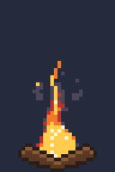
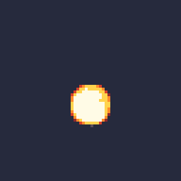
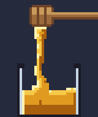
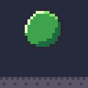
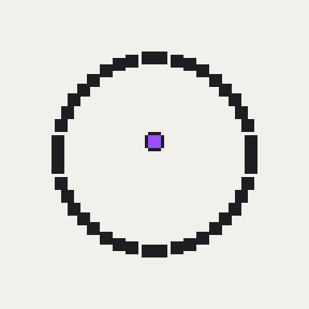
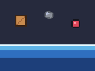

# Pixelbolt

[English](https://github.com/skulitom/Pixelbolt/blob/main/README.md) · [简体中文](https://github.com/skulitom/Pixelbolt/blob/main/README.zh-CN.md) · [日本語](https://github.com/skulitom/Pixelbolt/blob/main/README.ja.md) · [한국어](https://github.com/skulitom/Pixelbolt/blob/main/README.ko.md) · [Español](https://github.com/skulitom/Pixelbolt/blob/main/README.es.md) · [Português](https://github.com/skulitom/Pixelbolt/blob/main/README.pt-BR.md) · Русский

> Это краткое изложение английского README на русском языке. Подробности о каждой функции, ограничения и последние изменения смотрите в [README на английском](https://github.com/skulitom/Pixelbolt/blob/main/README.md). При расхождениях верным считается английский README.

**Пиксель-арт и анимация спрайтов, которые ваш ИИ-агент может нарисовать, проверить и исправить.** Pixelbolt превращает редактируемый JSON-рецепт в спрайты, тайлы, иконки, эффекты и короткие анимации и экспортирует их как спрайт-листы PNG, атласы текстур, анимированные PNG (APNG), GIF и пронумерованные кадры PNG для видеоредактора. Агенты работают с ним через локальный MCP-сервер или командную строку, а вы можете открыть, проиграть и отредактировать тот же рецепт в локальной студии в браузере.


- **[Галерея](https://skulitom.github.io/Pixelbolt/gallery/):** 66 эффектов, спрайтов и сцен в стиле пиксель-арт, сделанных в Pixelbolt 0.11.0. Все они анимированы, и от каждого один клик до его рецепта в песочнице.
- **[Попробуйте в браузере](https://skulitom.github.io/Pixelbolt/playground/):** рендер, экспорт и обмен рецептами без установки.
- **[Поиграйте с пикселями](https://skulitom.github.io/Pixelbolt/playground/fluids/):** подуйте на живой пиксельный костёр, налейте мёд и слизь, а потом сохраните GIF или поделитесь ссылкой, которая воспроизводит ровно то, что вы сделали.
- **[Руководства по эффектам](https://skulitom.github.io/Pixelbolt/guides/) (на английском):** огонь, взрывы, дым и пар, вода, слизь и мёд, магия, у каждого рецепты, которые открываются в песочнице. Там же: спрайт-листы в Paper2D для Unreal Engine 5, бесплатные наборы автотайлов для Godot 4 и Tiled и шесть бесплатных спрайт-листов пиксельного водопада.
- **[Neon Voyage](https://skulitom.github.io/NeonRocketGame/):** бесплатная браузерная игра, сделанная в Pixelbolt. Каждый спрайт, эффект и буква — это [рецепт](https://github.com/skulitom/NeonRocketGame/tree/main/art), а выхлоп ракеты — живая симуляция жидкости, которая изгибается, когда вы поворачиваете.

 

Огонь, дым, пар, взрывы, магия, вода, мёд, слизь и песок получаются из настоящей симуляции жидкости. Она идёт на вашем собственном процессоре гораздо меньше секунды и запекает каждый кадр в редактируемые пиксели палитры, с бесшовными циклами (см. [Жидкости и твёрдые тела](#жидкости-и-твёрдые-тела)).

- **Для кого:** разработчики игр, команды геймджемов, веб- и видеоавторы, которые хотят, чтобы агент вроде Claude, Codex или Cursor рисовал и правил их пиксель-арт, а также те, кто строит агентов, которым нужны точные и воспроизводимые изображения.
- **Используйте, когда** вам нужны небольшие 2D-ассеты для игр, которые остаются редактируемыми как текст: агент заново читает каждый пиксель, исправляет один пиксель или один кадр, не перерисовывая остальное, а один и тот же рецепт всегда даёт одно и то же изображение.
- **Не используйте для** живописных или фотографических изображений, больших анимаций (кадр анимации — не больше 1024 пикселей по стороне и 262 144 пикселей, например 320 × 180, 640 × 360 или 512 × 512, а проект — не больше 256 кадров и 4 194 304 пикселей в сумме, то есть 72 кадра 320 × 180; одиночное неподвижное изображение, например фон или фреска 1920 × 1080, может иметь до 4096 пикселей по стороне в пределах этой суммы), генерации арта моделью изображений, а также редактирования GIF и файлов Aseprite (импортируется только PNG до 8 бит на канал).

## Попробуйте

Нужен только Node.js 20 или новее. Больше ничего устанавливать не надо: ни ключа API, ни сетевого сервиса:

```sh
git clone https://github.com/skulitom/Pixelbolt.git
cd Pixelbolt
node bin/pixelbolt.js preview --open
```

В браузере откроется локальная студия (обычно по адресу http://127.0.0.1:4747; если порт занят, она берёт свободный и показывает его адрес). Выберите лесного духа, костёр или монету, отредактируйте JSON, посмотрите анимацию или спрайт-лист и скачайте ZIP с ассетами. В студии есть скорость воспроизведения, выбор кадров, масштабирование в целое число раз, пиксельная сетка, «луковая кожура» (onion skin), просмотр палитры, скачивание текущей анимации в GIF и восстановление несохранённых правок.


Ассет можно сделать и без браузера:

```sh
node bin/pixelbolt.js init hero.pixel.json
node bin/pixelbolt.js validate hero.pixel.json
node bin/pixelbolt.js inspect hero.pixel.json --out hero-frames.png
node bin/pixelbolt.js render hero.pixel.json --out output/hero
```

`inspect` сохраняет контактный лист со всеми кадрами и перечисляет длительность каждого; с `--grid` он возвращает кадры как текст из ключей палитры. `node bin/pixelbolt.js gif hero.pixel.json --out hero.gif` сохраняет анимацию в GIF, чтобы ею поделиться. Кроме справки и сервера предпросмотра, все команды отвечают в JSON. Ошибки пишутся в stderr, и команда завершается с кодом 1. Существующие выходные файлы защищены; чтобы заменить их, добавьте `--force`.

До версии 0.8.0 Pixelbolt назывался PixelForge. Команда `pixelforge` по-прежнему работает как псевдоним, а рецепты сохраняют свои метки формата `pixelforge-*`, так что ваши файлы и настройки агентов продолжают работать.

## Подключите к агенту

**Навык для Claude Code:** одна строка устанавливает навык пиксель-арта, без клонирования и без настройки MCP-сервера (Pixelbolt 0.9.2 или новее):

```sh
npx -y pixelbolt@latest skill install
```

Навык ставится в `~/.claude/skills/pixelbolt-pixel-art/` (`--project` ставит его в `.claude/skills/` текущей папки, а `--dir` — в любую папку навыков). Навык запускает каждую упомянутую в нём команду через `npx -y pixelbolt@<эта версия>`, а установщик никогда не заменяет изменённую вами копию, если вы не добавите `--force`.

Для Codex, Cursor и других агентов, которые поддерживает открытый [CLI навыков](https://skills.sh), используйте `npx skills add skulitom/Pixelbolt`. Он копирует только файл навыка, который затем запускает Pixelbolt через npx. CLI навыков требует Node.js 22.20 или новее и отправляет данные о каждой установке в рейтинг skills.sh, если не задано `DISABLE_TELEMETRY=1`.

**Плагин для Claude Code:** одна команда устанавливает MCP-сервер и тот же навык (Claude Code 2.1.292 или новее):

```
claude plugin install pixelbolt --marketplace skulitom/Pixelbolt
```

Внутри сеанса `/plugin install pixelbolt --marketplace skulitom/Pixelbolt` делает то же самое, начиная с Claude Code 2.1.275. В более ранних версиях сначала добавьте маркетплейс командой `claude plugin marketplace add skulitom/Pixelbolt`, затем выполните `claude plugin install pixelbolt@pixelbolt`. Ссылки на файлы разрешаются внутри папки проекта, открытой в Claude Code, а экспорт идёт в её папку `output/`. После установки перезапустите Claude Code.

**Claude Desktop:** скачайте [`pixelbolt.mcpb`](https://github.com/skulitom/Pixelbolt/releases/latest/download/pixelbolt.mcpb) из последнего релиза и откройте его (или установите из файла в Settings → Extensions). Выберите рабочую папку для рецептов и арта и попросите агента вызвать `pixel_help`.

**Другие MCP-клиенты (Codex, Cursor и т. д.):** пакет npm запускает сервер без клонирования (Node.js 20 или новее). Добавьте его в MCP-конфигурацию агента и замените `/absolute/path/to/pixelbolt-output` на папку, куда сохранять экспорт. Указывайте абсолютный путь, потому что каждый клиент запускает серверы из своей папки; в Windows используйте прямые слеши (`/`), например `C:/Art/pixelbolt-output`:

```json
{
  "mcpServers": {
    "pixelbolt": {
      "command": "npx",
      "args": ["-y", "pixelbolt@latest", "mcp", "--out", "/absolute/path/to/pixelbolt-output"]
    }
  }
}
```

Для клиентов с конфигурацией в TOML (например, Codex):

```toml
[mcp_servers.pixelbolt]
command = "npx"
args = ["-y", "pixelbolt@latest", "mcp", "--out", "/absolute/path/to/pixelbolt-output"]
```

В Windows клиент, который запускает сервер без оболочки, не может выполнить `npx` (Kimi Code сообщает `spawn npx ENOENT`). В этом случае используйте `"command": "cmd"` и `"args": ["/c", "npx", "-y", "pixelbolt@latest", "mcp", "--out", "C:/Art/pixelbolt-output"]`. Как запустить клонированный репозиторий (например, `main`, который может опережать npm) и как настроить Kimi Code, DeepSeek Harness и OpenCode, смотрите в разделе [Connect an agent through MCP](https://github.com/skulitom/Pixelbolt#connect-an-agent-through-mcp) английского README.

Pixelbolt есть в официальном MCP Registry как `io.github.skulitom/pixelbolt`.

### Восемь инструментов MCP

- **`pixel_help`:** короткое введение (формат рецепта, операции, инструменты и порядок работы). Начинайте с него. С `topic` возвращает полное руководство по созданию (`guide`), художественный процесс (`workflow`), JSON Schema рецептов (`schema`), полный пример (`example`) или схемы `poses`, `scenes`, `autotile`, `fx`, `fluid`, `wave`, `crystal`, `powder`, `bodies` и `normals`. Тема `presets` перечисляет встроенные пресеты (огонь, дым, взрывы, заклинания, жидкости, плазма, твёрдые тела, кристаллы, падающий песок, персонажи), которые можно скомпилировать, а не рисовать.
- **`pixel_validate`:** проверяет рецепт и сохраняет его ревизию без экспорта ассетов. Сообщает о каждом месте, обрезанном холстом; с `"fps": 30` также показывает, какие длительности не попадают в эту сетку видеокадров.
- **`pixel_inspect`:** контактные листы, точные сетки по областям, силуэт, оттенки серого и «луковая кожура», повтор тайла 3×3, чтобы видеть швы, исходный размер, диагностика, разбор движения (опора ног и стык цикла) и направляющие перспективы (горизонт, точки схода, изометрическая сетка).
- **`pixel_patch`:** исправляет только нужное правками `set`, `insert`, `remove` и `paint`. Например, `{ "paint": "frames[blink]", "value": [{ "x": 9, "y": 7, "color": "k" }] }` исправляет пиксель в итоговых координатах холста, поверх всех слоёв. Возвращает каждый кадр, где изменились пиксели (с точными пикселями, если правка небольшая), и PNG «до и после». Исходный рецепт не меняется, а каждая успешная правка создаёт новую ревизию.
- **`pixel_render`:** экспортирует спрайт-лист, JSON-атлас, PNG каждого кадра, APNG, CSS и Canvas-проигрыватель и возвращает контактный лист всех кадров. С `"gif": {}` также пишет GIF, а с `"sequence": { "fps": 30, "size": "1080p" }` — пронумерованные кадры PNG для видеоредактора. Каждый вызов пишет в новую папку внутри папки вывода.
- **`pixel_compile`:** компилирует в обычный рецепт источники поз, автотайлов, эффектов частиц и заклинаний (fx), жидкостей (fluid), волн (wave), кристаллов (crystal), падающего песка (powder), твёрдых тел (bodies) и карт нормалей (normals). С `preset` компилирует встроенный пресет по имени.
- **`pixel_scene`:** рендерит манифест сцены (тайловые карты с легендами автотайлов, именованные сигналы (cues), траектории, прикреплённые объекты, порядок отрисовки по земле, точечные источники света и солнце с отбрасываемыми тенями, камера с панорамированием и параллаксом), экспортирует её (с картой Tiled, слои которой несут параллакс каждого плана, `scene.tmx`, копиями дальних ассетов с дымкой и сценой Godot, которая прокручивает каждый план через `Parallax2D`, `scene.tscn`) или записывает её как пронумерованные кадры PNG.
- **`pixel_import`:** импортирует PNG в исходном разрешении (RGB, RGBA, оттенки серого или индексированный, до 8 бит на канал) как редактируемую ревизию рецепта без потерь.

Каждый успешный ответ инструментов для рецептов содержит id `revision`, который другие инструменты принимают вместо полного рецепта, так что пересылать его заново не нужно. Ревизии хранятся как неизменяемые снимки в `.revisions/` внутри папки `--out` MCP-сервера и переживают перезапуски, если папка та же.

## Крошечная анимация

```json
{
  "version": 1,
  "name": "slime",
  "width": 8,
  "height": 8,
  "palette": { "g": "#72b58d", "e": "#20383f" },
  "frames": [
    {
      "name": "rest",
      "duration": 180,
      "ops": [{ "op": "grid", "x": 1, "y": 3,
        "rows": [".gggg.", "ggeegg", "gggggg", ".gggg."] }]
    },
    { "name": "up", "from": "rest", "translate": [0, -1], "duration": 180 }
  ],
  "animations": { "bounce": { "frames": ["rest", "up"] } }
}
```

Каждый символ текстовой сетки выбирает цвет из палитры; `.` и пробел оставляют пиксели как есть. Наследование кадров позволяет описывать небольшие изменения коротким текстом. Рендер детерминирован и работает в целочисленных пиксельных координатах.

## Жидкости и твёрдые тела

Источник `pixelforge-fluid` запускает небольшую детерминированную симуляцию жидкости и компилирует её в обычный рецепт из сеток палитры: газы с плавучестью и завихрениями; жидкости, текучие как вода, густые как мёд или упругие как слизь; песок, который держит свой откос; электрические дуги и плазма; лёд, который тает, и вода, которая замерзает и кипит. Плотность, температура и скорость переводятся в цветовые рампы вашей палитры с упорядоченным дизерингом (ordered dither), поэтому цвета не из палитры никогда не появляются.

 

Источник `pixelforge-bodies` бросает мячи, ящики, многоугольники и вращающиеся обручи на холст с гравитацией, стенами и нарисованными пиксельными препятствиями: они отскакивают, скользят, катятся, складываются в стопки и останавливаются, а всё это запекается в сетки палитры, как и в других компиляторах. Шарниры соединяют тела в рэгдоллы, верёвки провисают и рвутся, а ткань крепится к телам, развевается на ветру, драпируется и рвётся. Те же тела работают внутри жидкости: в воде они плавают или тонут в зависимости от плотности, а на осыпающемся песке съезжают вместе с ним.

 

```sh
node bin/pixelbolt.js compile examples/campfire.fluid.json --out output/campfire.json
node bin/pixelbolt.js gif output/campfire.json --scale 4 --out output/campfire.gif
```

Источник `pixelforge-crystal` выращивает из затравок кварц, аметист, пирит, друзы, жеоды и снежинки, освещённые по граням, а `pixelforge-powder` — песочница «падающего песка», где каждый пиксель — песок, вода, камень, дерево, огонь, дым, лава, лёд или ваш собственный материал.

Пресеты лежат в [examples/](https://github.com/skulitom/Pixelbolt/tree/main/examples) (`*.fluid.json`, `*.bodies.json`, `*.crystal.json` и `*.powder.json`). Агенты компилируют их через MCP-инструмент `pixel_compile` и читают формат в темах `fluid`, `bodies`, `crystal` и `powder` инструмента `pixel_help`. В студии **Fluid lab** (`/fluid.html`) запускает тот же компилятор в браузере: выберите пресет, подвиньте несколько ползунков и скачайте GIF, спрайт-лист или рецепт. **Effects lab** (`/effects.html`) делает то же с пресетами заклинаний и частиц `pixelforge-fx`, а **Powder lab** (`/powder.html`) запускает песочницу вживую.

## Экспортируемые файлы

| Файл | Назначение |
| --- | --- |
| `name.png` | Спрайт-лист PNG RGBA с настраиваемыми столбцами, отступами и целочисленным масштабом или упакованный по видимой области с `sheet.trim` |
| `name.atlas.json` | JSON-атлас в стиле TexturePacker: прямоугольники, смещения обрезки, исходные размеры, точки опоры и якоря, именованные точки, длительности кадров, именованные анимации и метки кадров в стиле Aseprite |
| `name.tres` | `SpriteFrames` Godot 4 для `AnimatedSprite2D` с циклом и точными таймингами каждой анимации; положите рядом с `name.png` |
| `name.tileset.tres` | Только для наборов тайлов: `TileSet` Godot 4 для `TileMapLayer` с вероятностью и коллизией каждого тайла, по которому кисть террейна Godot выбирает тот же тайл, что и тайловая карта Pixelbolt; положите рядом с `name.png` |
| `name.tsx` | Только для наборов тайлов: тайлсет [Tiled](https://www.mapeditor.org) с набором Wang для каждого террейна под кисть террейна, а также вероятностью, объектами коллизий и анимацией каждого тайла; положите рядом с `name.png` |
| `frames/*.png` | Каждый кадр как прозрачный PNG |
| `animations/*.png` | По APNG на анимацию, с сохранением прозрачности, таймингов кадров и цикла |
| `name.css` | CSS-классы анимации; поддерживает листы в несколько рядов и кадры разной длительности |
| `player.js` | Маленький Canvas-проигрыватель без зависимостей: воспроизведение, пауза, продолжение и именованные анимации, а также `loadSpriteSheet`, `frameAt` и `drawFrame` для игр |
| `name.pixel.json` | Редактируемый исходный рецепт |
| `preview.html` | Самостоятельный предпросмотр, который можно открыть прямо в браузере |

Файлы APNG намеренно имеют расширение `.png`. В Godot 4 положите `name.png` и `name.tres` в одну папку проекта и используйте `.tres` как Sprite Frames для `AnimatedSprite2D`. Phaser читает формат JSON hash через `load.atlas`; в других движках используйте прямоугольники атласа или отдельные PNG. Подробнее — в [заметках об интеграции с играми](https://github.com/skulitom/Pixelbolt/blob/main/docs/game-integration.md) (на английском).

## Дополнительная документация (на английском)

- [README на английском](https://github.com/skulitom/Pixelbolt/blob/main/README.md): все команды, экспорт, кадры для видеоредакторов, JavaScript API и переносные сборки
- [Руководство по созданию](https://github.com/skulitom/Pixelbolt/blob/main/docs/agent-guide.md): поля рецепта, операции рисования и ограничения
- [Художественный процесс](https://github.com/skulitom/Pixelbolt/blob/main/docs/art-workflow.md): проверка силуэта и тона, позы и движение, автотайлы, сцены, жидкости и твёрдые тела
- [Навык пиксель-арта](https://github.com/skulitom/Pixelbolt/blob/main/skills/pixelbolt-pixel-art/SKILL.md): повторяемый процесс создания и проверки
- [Примеры](https://github.com/skulitom/Pixelbolt/tree/main/examples) и [как делалась галерея](https://github.com/skulitom/Pixelbolt/blob/main/showcase/gallery/README.md)
- [llms.txt](https://github.com/skulitom/Pixelbolt/blob/main/llms.txt): указатель документации для агентов
- [CONTRIBUTING.md](https://github.com/skulitom/Pixelbolt/blob/main/CONTRIBUTING.md) и [AGENTS.md](https://github.com/skulitom/Pixelbolt/blob/main/AGENTS.md): как внести вклад. Об ошибках сообщайте в [GitHub Issues](https://github.com/skulitom/Pixelbolt/issues)

## Другие инструменты того же автора

Все они бесплатны, распространяются по лицензии MIT, работают локально и подключаются как MCP-серверы:

- [Anode](https://github.com/skulitom/Anode): автоматизация рабочего стола Windows в скрытом фоновом сеансе, чтобы агент мог кликать, печатать и делать снимки экрана, не захватывая ваш экран.
- [Cutbolt](https://github.com/skulitom/Cutbolt): движок видеомонтажа с точными таймлайнами, субтитрами и рендером.
- [Inkbolt](https://github.com/skulitom/Inkbolt): редактирование векторных и растровых изображений для диаграмм и иллюстраций, с импортом SVG и экспортом в SVG и PDF.
- [Nestbolt](https://github.com/skulitom/Nestbolt): 2D-раскрой деталей на листах для лазерной, фрезерной (ЧПУ), плазменной и гидроабразивной резки, также [в браузере](https://skulitom.github.io/Nestbolt/).

## Лицензия

[Лицензия MIT](https://github.com/skulitom/Pixelbolt/blob/main/LICENSE). Входящий в комплект арт оригинален и распространяется по той же лицензии.
