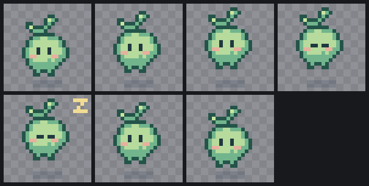
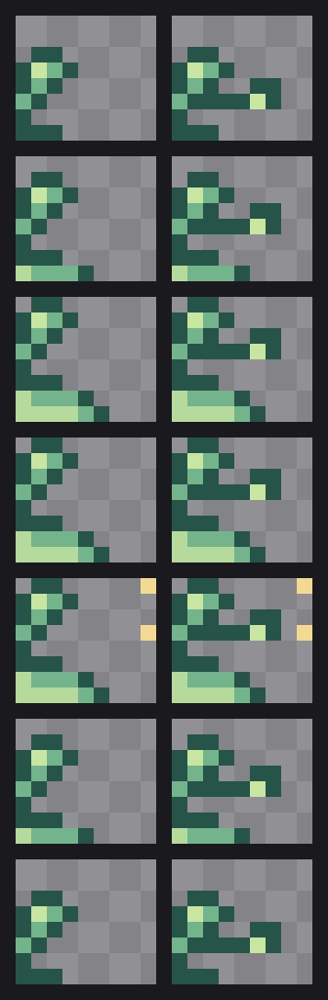
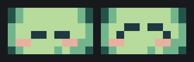
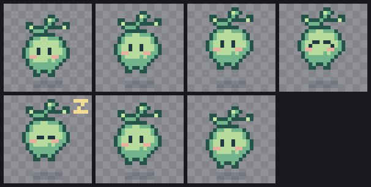

# Fix one frame without redrawing the character

A blink, a hit flash or one bad pose often needs a fix while every other frame is already right. Pixelbolt edits a recipe in place, so a fix is a few pixels, not a redraw, and its reply lists every frame whose pixels changed. Two choices decide how far an edit reaches:

- An edit to a **base pose** reaches every frame built from it. That is what you want when the character itself changes.
- An edit with **`"scope": "frame"`** changes only the frame you name, even when other frames are built from it.

This walk-through does both on a small sprite: it edits the base pose and reads which frames changed, then fixes only the blink. Every file is in [`examples/fix-one-frame/`](../examples/fix-one-frame/), and every picture below was made by the commands shown.

## The example

[`mossling.json`](../examples/fix-one-frame/mossling.json) is a 24 × 24 forest spirit with seven frames. Only `rest` is drawn; every other frame is built from an earlier frame with `from` (and moved with `translate`), the way a recipe shares a base pose between its frames:

| Frame | Built from | What it adds |
|---|---|---|
| `rest` | (drawn) | the body and its shadow: the base pose |
| `rise`, `fall` | `rest` | the body one pixel up, the shadow redrawn on the ground |
| `float` | `rest` | the body two pixels up, the shadow redrawn |
| `blink` | `float` | flat closed eyelids |
| `doze` | `blink` | a Z above the head |
| `settle` | `rest` | nothing: the same picture, held for a different time |

`idle` plays `rest, rise, float, blink, float, fall, settle`, and `sleep` plays `blink, doze`.



Run the commands below from a Pixelbolt checkout (`node bin/pixelbolt.js` in place of `pixelbolt` works too), or copy the three JSON files into a folder of your own.

## 1. Edit the base pose: every frame built from it changes

[`base-edit.json`](../examples/fix-one-frame/base-edit.json) gives the sprout a second leaf on `rest`. A `grid` change writes palette keys into a region; a dot keeps the pixel that is there:

```json
[
  { "grid": "frames[rest]", "value": { "x": 13, "y": 5, "rows": ["...dd", "dddLd"] } }
]
```

```sh
pixelbolt patch examples/fix-one-frame/mossling.json --changes examples/fix-one-frame/base-edit.json --out leafy.json --image base-edit.png
```

The reply's `frames.changed` names every frame whose pixels changed, with how many and where. All seven frames are built from `rest`, so all seven show the leaf, moved with the body in the frames that rise:

```json
"changed": [
  { "frame": "rest", "pixels": 7, "box": { "x": 13, "y": 5, "w": 5, "h": 2 }, ... },
  { "frame": "rise", "pixels": 7, "box": { "x": 13, "y": 4, "w": 5, "h": 2 }, ... },
  { "frame": "float", "pixels": 7, "box": { "x": 13, "y": 3, "w": 5, "h": 2 }, ... },
  { "frame": "blink", ... }, { "frame": "doze", ... }, { "frame": "fall", ... }, { "frame": "settle", ... }
],
"unchanged": []
```

`--image` draws each changed frame before and after, cropped to what changed:



A frame that is not built from the edited one would be listed under `unchanged`. Read this list before you accept an edit: it is the whole effect of the change.

## 2. Fix only the blink

In the idle loop the flat lids make the spirit look asleep for a moment. The blink should be a quick, happy one with curved lids, while `doze`, which is built from the blink, keeps its sleepy flat lids. [`blink-fix.json`](../examples/fix-one-frame/blink-fix.json) redraws the eyes on `blink` with `"scope": "frame"`:

```json
[
  { "grid": "frames[blink]", "scope": "frame", "value": { "x": 8, "y": 10, "rows": ["hkkhkkh", "khhhhhk"] } }
]
```

```sh
pixelbolt patch leafy.json --changes examples/fix-one-frame/blink-fix.json --out fixed.json --image blink-fix.png
```

Only the blink changed. The edit reports the frame it protected and how many of its pixels it held in place:

```json
"edits": [
  { "grid": "frames[blink]", "at": "frames[3]", "pixels": 14, "scope": "frame", "protected": [{ "frame": "doze", "pixels": 10 }] }
],
"frames": {
  "changed": [{ "frame": "blink", "pixels": 10, "box": { "x": 8, "y": 10, "w": 7, "h": 2 }, ... }],
  "unchanged": ["rest", "rise", "float", "doze", "fall", "settle"]
}
```



The other six frames are byte-for-byte what they were, `doze` included. The same change without `"scope": "frame"` would have reached `doze` too: its reply lists `blink` and `doze`, 10 pixels each.



## What `"scope": "frame"` does

- It applies to the canvas changes (`paint`, `grid`, `move`, `recolor` and `cleanup`). The default, `"inherited"`, lets the edit flow on to every frame built from the one you change.
- To keep the other frames as they were, it adds per-pixel corrections (the frame's `pixels` list) to each later frame the edit would have changed. `doze` now holds ten of them, named by the palette key that drew each pixel. Read them with `pixelbolt inspect fixed.json --frames doze --grid`.
- Only frames after the one you patch can be built from it (`from` names an earlier frame), so only those are protected.
- To fix a few frames, send one change per frame, each with `"scope": "frame"`. To change the character everywhere, patch its base pose (or the symbol it stamps) at the default scope, as in step 1.
- Keep the original: `--out` refuses a file that exists unless you pass `--force`, and a patch that fails writes nothing.

## The same edits through MCP

`pixel_patch` takes the same `changes` lists, with the recipe as `project` (or the `revision` id a previous reply returned). Its reply has the same `edits` and `frames` lists and a before/after PNG of the changed frames, plus a new `revision` for the next call. `pixel_inspect` with `frames: ["blink", "doze"]` shows the result, and `grid: true` reads the exact pixels.

## Make the pictures yourself

```sh
pixelbolt inspect examples/fix-one-frame/mossling.json --scale 6 --out before.png
pixelbolt inspect fixed.json --scale 6 --out after.png
```

The before/after images come from `patch --image` above. More on regional changes, masks and the work limit: [Regional corrections and scope](art-workflow.md#regional-corrections-and-scope).
