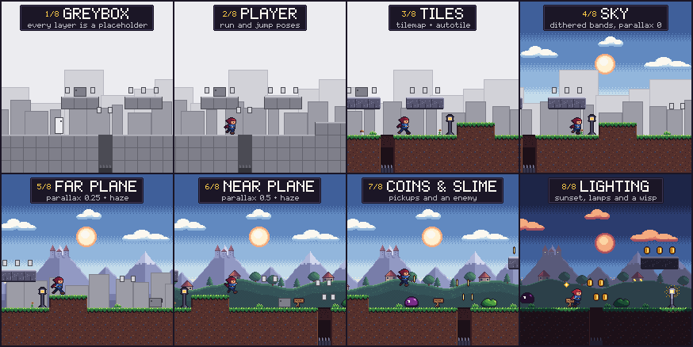

# Greybox reel

A 12-second square reel. One side-view platformer screen goes from grey placeholder boxes to finished art, one layer at a time, with a caption for each layer, then loops back to the greybox. Every stage is an ordinary Pixelbolt recipe or scene, written as text and rendered locally and deterministically. No image model is involved, and every pixel comes from a recipe.



The reel is 216 × 216 pixels at 5×, exactly 1080 × 1080 at 30 fps: 360 frames from `pixelbolt sequence`. A 432 × 432 GIF comes from `pixelbolt gif-frames`, and an MP4 comes from the ffmpeg command that `sequence` prints. The frames, GIF and MP4 are large, so they stay out of git; `build.mjs --reel` remakes them in about half a minute.

## Stages

| Cue | Stage | What changes |
| --- | --- | --- |
| 0.0 s | Greybox | Grey boxes for the player, coins and slime; a gridded grey ground with a pit; blocks for the far and near planes. The camera already scrolls right at 30 px/s. |
| 1.4 s | Player | The box becomes the hooded hero: a six-pose run plus rise and fall poses, drawn from parts and outlined in one pass. |
| 2.7 s | Tiles | The same tilemap shows grass, dirt, stone slabs and a staked pit (cardinal autotile). Rules scatter tufts, flowers, stones and mushrooms. Lamps, bushes and a sign arrive. |
| 4.0 s | Sky | Dithered bands from blue to a warm horizon, a sun and slow clouds replace the flat grey background. |
| 5.3 s | Far plane | A 256-pixel repeating mountain range with a castle, at parallax 0.25, faded by the scene's haze. |
| 6.6 s | Near plane | A village on a rolling hill, at parallax 0.5 with lighter haze. |
| 7.9 s | Coins & slime | Spinning coins that sparkle when collected, and a hopping slime the hero jumps over. |
| 9.2 s | Lighting | Ramp lighting fades the playfield to dusk while the backdrops cycle to evening palettes. The sun sets behind the mountains, lamps, windows and a wisp light up, and stars come out. From 10.8 s the caption reads "PIXELBOLT: text recipes, no image model". |

## Build and render

```sh
node showcase/greybox-reel/build.mjs --check          # the committed sources match the script
node showcase/greybox-reel/build.mjs --force          # rewrite art/ and stages.png
node showcase/greybox-reel/build.mjs --reel           # also render output/greybox-reel/: frames, frames-432, greybox-reel.gif
node bin/pixelbolt.js preview showcase/greybox-reel/art/reel.scene.json   # scrub it in the studio
```

`--reel` runs these commands (adding `--force` when you pass it):

```sh
node bin/pixelbolt.js sequence showcase/greybox-reel/art/reel.scene.json --out output/greybox-reel/frames --fps 30 --size 1080x1080
node bin/pixelbolt.js sequence showcase/greybox-reel/art/reel.scene.json --out output/greybox-reel/frames-432 --fps 30 --size 432x432
node bin/pixelbolt.js gif-frames output/greybox-reel/frames-432 --fps 30 --out output/greybox-reel/greybox-reel.gif
```

The `README.txt` that `sequence` writes beside the frames gives the ffmpeg commands. Run in `output/greybox-reel/frames`, the H.264 4:2:0 one plays everywhere and suits posting:

```sh
ffmpeg -framerate 30 -start_number 1 -i "greybox-reel_%04d.png" -c:v libx264 -preset slow -crf 14 -pix_fmt yuv420p -vf "scale=out_color_matrix=bt709:flags=neighbor" -colorspace bt709 -color_primaries bt709 -color_trc bt709 "../greybox-reel.mp4"
```

The lossless 4:4:4 command from the same file keeps every colour, for players built on ffmpeg.

## How it is made

`build.mjs` is the source of truth. It writes ordinary recipes into `art/` and refuses to overwrite them unless you pass `--force`; `npm test` runs `--check`.

- **One scene, one clock.** `reel.scene.json` names each stage as a cue. Each layer has a grey stand-in and its art. The art placement is `hidden` until its cue; the stand-in hides at the same cue, or switches frame when both share an asset (the hero, coins and slime each keep a `grey` frame).
- **A tilemap that changes at a cue.** Tilemap placements take no cues, so each tile's legend names an animation: the grey frame lasts 2.7 s, then the art frame holds (`loop: false`). The ground and the slabs are cardinal autotiles from 2×3-tile templates, with a grey twin of each template. Decorations are rules that draw into the cell above a grass top, by seeded chance.
- **Camera, parallax and haze.** The camera pans 360 px in 12 s, one pixel per video frame. The sky and captions stay fixed (parallax 0), clouds drift at 0.1, mountains at 0.25 and the village at 0.5. Both planes repeat a 256-pixel drawing, and `haze` fades them toward a lavender sky colour, one colour at a time.
- **Lighting without leaving the palette.** `lighting.mode: "ramp"`: an overhead fill sun (a sun at `[0, 0]` casts no shadows) keeps every colour as drawn until the lighting cue, then fades out while a low sun fades in. The playfield then drops two steps down its ramps. The lamps and the wisp are point lights that follow their placements and flicker. The backdrops stay `lit: false`, so lamp light stays on the ground; their evening is palette cycling instead: dusk and night frames move each key down its ramp. Windows light one by one through frame-by-frame glow overlays.
- **Captions** use the `text` operation on a dark label, one frame per stage, sliding in on a trajectory.
- **Choreography.** The hero runs at the camera's speed and jumps the pits, onto the raised ground and over the slime. Jumps are `lift` keys, so each jump arcs over the hero's ground line. The coins sit on the jump arcs, placed with the scene's own easing, and switch to a sparkle when the hero passes through them.

## Review

The art was judged by eye at 1× (`stages.png`), at 2–4× crops, and as 1080 frames viewed at phone size. These came up and were fixed:

- The jump over the slime passed through a stone slab, so the slab moved.
- The setting sun slid under a cloud and read as a mushroom cloud, so it now sets in the gap between clouds, behind a peak.
- Lamp light washed over the mountains, so the backdrops became unlit with palette-cycled evenings.
- The far mountains turned pale at night, so their night palette goes three steps down.
- The castle floated above its peak and now sits into it.
- The slime was a featureless puddle and was redrawn taller, with a big eye.
- The caption's small line was unreadable with an outline and now sits on a dark label.

Known limits:

- The lamp's dithered halo reads more as sparkle than as soft glow.
- The 4:2:0 MP4 shares colour between 2 × 2 pixels; at the odd 5× enlargement some edges change by up to 181 levels, though a decoded frame is indistinguishable from the source at 1:1 (mean PSNR 39 dB). The lossless 4:4:4 MP4 is within one level.
- Pillow decodes the GIF to exactly the 432-pixel frames: 360 frames that loop forever, with 30 and 40 ms delays totalling 12,000 ms.

| File in `art/` | What it is |
| --- | --- |
| `hero.json` | The hero: grey box, six run poses, rise and fall, with a `wisp` point |
| `coin.json`, `slime.json`, `wisp.json` | Pickup with spin and sparkle; the enemy's hop; the companion light |
| `tiles.json` | Ground and slab autotile templates and their grey twins, the pit, decorations; each tile an animation from grey to art |
| `props.json` | Lamp posts (off, and on with a halo layer), bush, sign |
| `sky.json`, `sun.json`, `clouds.json`, `stars.json` | The sky with day, dusk and night frames; the sun; clouds that warm at sunset; twinkling stars |
| `far.json`, `far-glow.json` | Mountains and castle with evening frames; the castle's windows lighting up |
| `near.json`, `near-glow.json` | The village on its hill with evening frames; its windows lighting up |
| `grey-far.json`, `grey-near.json` | The greybox blocks for both planes |
| `caption.json` | One caption per stage, and the credit |
| `reel.scene.json` | The reel: cues, camera, haze, lighting and every placement |
