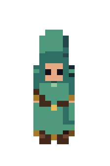

# Hooded Wanderer: a character that turns



[`hooded-wanderer.stack.json`](hooded-wanderer.stack.json) is a small hooded traveller drawn as a sprite stack: 16 horizontal slices of a 13 × 13 grid, ground first, in the default top-down `oblique` view at `resolution: 3`. The face, belt buckle and boots show the front; a backpack with a bedroll and the hood's point show the back. `ramps` shade it: a face toward the light draws one key lighter, and a face turned from it one key darker. The GIF above shows its 16 baked headings at 4×, 110 ms each.

It is the top-down companion to [`iso-villager`](../../examples/iso-villager.stack.json), a figure made of parts that walks on an isometric map. The wanderer is one solid with no parts, so its `--slices` sheet holds the whole figure and a game can turn it to any angle as it runs. It has no walk: a walk needs parts, and a slice sheet leaves parts out.

## Render it

From the repository's root:

```sh
node bin/pixelbolt.js validate showcase/hooded-wanderer/hooded-wanderer.stack.json
node bin/pixelbolt.js gif showcase/hooded-wanderer/hooded-wanderer.stack.json --animation turn --scale 4 --out output/hooded-wanderer/turn.gif
node bin/pixelbolt.js render showcase/hooded-wanderer/hooded-wanderer.stack.json --out output/hooded-wanderer/baked --look
node bin/pixelbolt.js compile showcase/hooded-wanderer/hooded-wanderer.stack.json --slices --out output/hooded-wanderer/slices.pixel.json --metadata output/hooded-wanderer/slices.meta.json
node bin/pixelbolt.js render output/hooded-wanderer/slices.pixel.json --out output/hooded-wanderer/slices --look
node bin/pixelbolt.js inspect showcase/hooded-wanderer/hooded-wanderer.stack.json --diagnostics --palette --out output/hooded-wanderer/inspect.png
```

With the released CLI, copy `hooded-wanderer.stack.json` to a folder outside a Pixelbolt checkout and run the same commands there with `npx -y pixelbolt@0.20.0` in place of `node bin/pixelbolt.js`. Inside a checkout, `npx -y pixelbolt@0.20.0` fails on Windows with "'pixelbolt' is not recognized", because the checkout's own package is named `pixelbolt`. When this page was written, 0.20.0 and the repository's CLI wrote byte-identical files for this stack.

## What you get

| File under `output/hooded-wanderer/` | What it is |
| --- | --- |
| `turn.gif` | The turntable: 16 headings of 110 ms, 224 × 336 (4×), looping, 17 colours. |
| `baked/hooded-wanderer.png` | The baked sheet for a game: 16 frames of 56 × 84 in 8 columns, named `heading-0` to `heading-338`, played by the animation `turn`. |
| `baked/hooded-wanderer.atlas.json` | Its atlas. `meta.headings` gives the frame at each heading and `toward`, the way the figure faces on screen: down at 0, left at 90, up at 180, right at 270. |
| `baked/hooded-wanderer.tres` | A Godot SpriteFrames of the baked sheet, beside `frames/`, `preview.html` and `look.png`. |
| `slices.pixel.json` | The slices as a recipe: 16 frames of 13 × 13, `slice-0` on the ground, in the animation `slices`. |
| `slices.meta.json` | The pivot the slices turn about (`[6.5, 6.5]`), `spacing` 1 and `squash` 0.65. |
| `slices/hooded-wanderer.png` | The slice sheet, 208 × 13, with its atlas and `.tres`. |

`inspect --diagnostics` reports no findings and no stray pixels at any heading. `--palette` lists the five ramps and the colours each one uses.

## Turning it at run time

Stacked with `drawStack` from the bundle's `player.js` at `scale: 3` (the stack's `resolution`) and `squash: 0.65`, the slices give the baked frame's outline exactly at 0, 90, 180 and 270 degrees. The tones differ: the slice sheet is lit from a light fixed to the stack, and the baked frames from the camera. Between the quarter turns, `heading` takes any angle, which 16 baked frames cannot.

## In Godot, with the addon

The [addon](../../docs/game-integration.md#the-editor-addon-recipes-as-spriteframes) imports a recipe as SpriteFrames: `.pixel.json` on Godot 4.5 and later, `.pixelbolt` on 4.3 and later.

- **Turning freely:** import `slices.pixel.json`. It becomes a SpriteFrames whose `slices` animation lists the slices. Attach the addon's `sprite_stack.gd` to a Node2D, give it that resource as `sprite_frames`, and set `heading` to turn the figure as the game runs. Set `squash` to 0.65, the stack's own (from the compile's metadata), for the baked view's slant.
- **Baked headings:** compile the baked recipe with `node bin/pixelbolt.js compile showcase/hooded-wanderer/hooded-wanderer.stack.json --out output/hooded-wanderer/baked.pixel.json` and import that file. A sprite stack imports with its headings as the resource's `headings` metadata, which the addon's `headings.gd` reads. [Facing and headings](../../docs/game-integration.md#facing-and-headings) shows how a game picks a heading's frame.

## Make it yours

Change the palette keys for a colour variant: `inspect --palette` lists which key colours what. Change `headings` for more or fewer views, and `resolution` for bigger or smaller pixels.

The recipe was written by an AI agent (Claude) for the Pixelbolt project. Like the rest of the repository, it is MIT-licensed.
