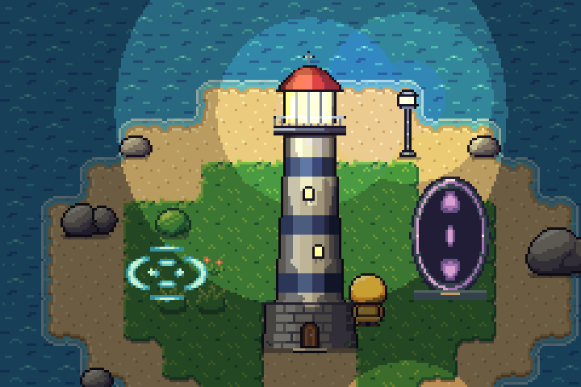
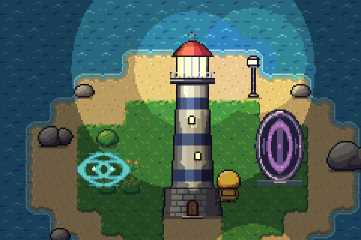

# Wave scene review



The limited visual gate passed on 26 October 2026. The paired cyan sources leave clear cancellation gaps, while the portal interior changes between bands and small bright forms. Its authored rim stays still. Both effects remain legible beside Tidewatch's keeper without covering the character.

## Brief

- **Purpose:** reusable magical interference and an oval portal interior for a small game scene.
- **Native size:** 48×30 interference; 38×56 portal; 240×160 scene. Review at native size and 3× scene / 4× isolated sprites, without smoothing.
- **Motion:** 40 frames at 60 ms (2.4 seconds), looping. Two fixed interference origins; a fixed portal rim and plinth.
- **Palette:** cyan for the ground effect; violet with warm rune accents and a slate frame for the portal. Palette colours remain exact.
- **Composition:** effects at `[69,113]` and `[186,121]` using their frame anchors; keeper at `[152,134]`. Raised scene ambient to 0.46 and cleared nearby props for the trial. Existing Tidewatch terrain, lights and animation remain the scene material.
- **Acceptance:** visible cancellation beyond a set of independent rings; recognizable portal silhouette through its whole loop; no player occlusion; stable palette and source regeneration; no conspicuous loop pause.

## Comparison and decision



This comparison uses the same field positions, palette and scene, but colours the strongest individual source with a 1.45 gain. It deliberately cannot cancel. It is an illustrative alternative, not the particle compiler or a physical reference. Its denser eye-like rings gave the interference patch less breathing room. The coherent version earns its small extra authoring surface through those gaps and the changing portal interior.

All 40 frames were inspected on native contact sheets, and both scene loops were viewed in browser playback. The fixed rim maintains readability while the interior changes. Small highlight islands and deliberate symmetry remain; this is magical pixel art, not a water simulation. The interference preset raises the narrow-wave advisory because its compressed vertical spacing is 5.5 pixels; this specific preset was retained after native and motion review. Do not treat that as permission to ignore warnings in new compositions.

The compiler's complete RGBA output is pinned in `goldens.json` and matches the original scene trial. The automated checks cover cancellation, reversal, frame subdivision, masks, source limits, palette links and CLI/MCP/studio use. The browser QA compares both presets' complete compiled results and every RGBA frame against Node. Independent image-decoder checks confirm the exported GIF frame count, timing and native scene pixels.

Initial integration validation: 518 tests and 39 browser checks passed. Pillow decoded all 80 sprite GIF frames to the expected native pixels with 60 ms timing, and both scene GIFs contained 40 frames with their review still matching the native PNG. Native grayscale contact sheets retained the paired origins, cancellation gaps and portal outline.

## Reproduce and edit

```sh
node showcase/waves/build.mjs --check
node bin/pixelbolt.js preview showcase/waves/scene.scene.json --open
node bin/pixelbolt.js preview examples/interference.wave.json --open
node bin/pixelbolt.js preview examples/portal.wave.json --open
```

Edit the preset definitions in `scripts/wave-presets.mjs`, regenerate examples with `node scripts/generate-examples.js`, then deliberately rebuild with `node showcase/waves/build.mjs --force` and review the result. Goldens are not updated by the builder; changes require deliberate review and a new hash. The builder reuses Tidewatch assets by relative reference and writes compiled editable recipes alongside the scene. Generated GIFs are previews; the recipes and original `.wave.json` files are the editable handoff. [Format and export guide](../../docs/wave-effects.md).

Deferred: shield-specific art, opening/closing or hit reactions, obstacle reflection, runtime physics, and a dedicated wave editor. The existing source editor and export pipeline are sufficient for this scope.
